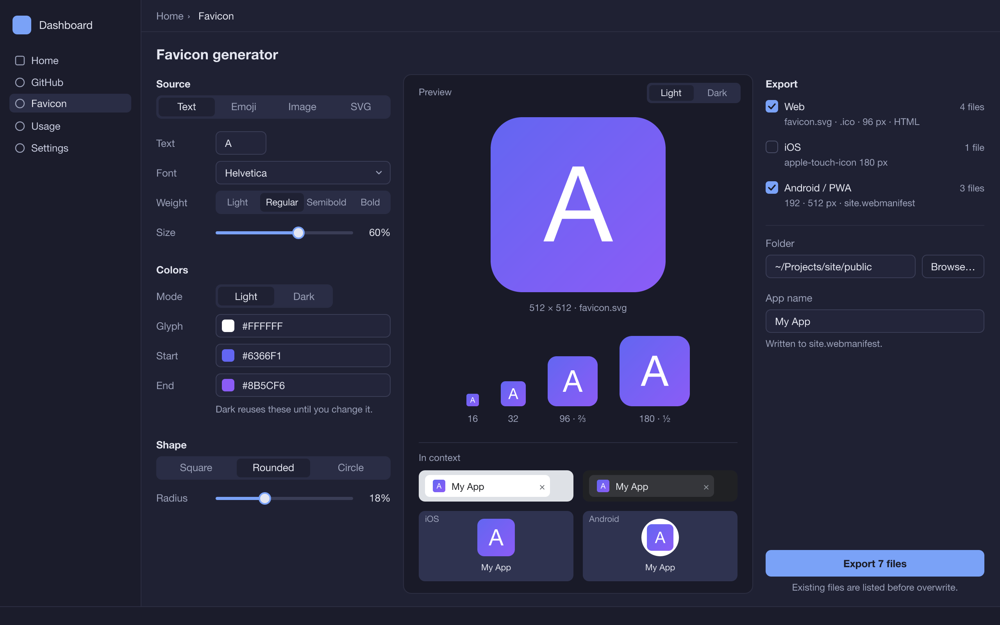

# 0064 — Favicon generator module

Status: implemented via #435 (the implementation PR for this doc).
Requirements #427; cut scope #428–#433. **S2 resolved at implementation:**
resvg 0.46 rasterizes color emoji natively (`spike_emoji_raster_has_color`,
macOS verified — the D12 fallback path stays designed but unneeded).

## 1. Context & problem

The dashboard's modules so far consume data (GitHub). #427 adds a
producer: an offline tool that turns a glyph, emoji, image, or SVG into a
platform-correct favicon/app-icon set, with **per-platform output
selection** (web / iOS / Android-PWA; Windows tiles and adaptive layers
are filed away). Everything the user needs today lives in web tools like
favicongenerator.io; we ship the same capability locally, riding the
module conventions, state store, toast hub, usage rail, and debug bridge.

## 2. Facts (receipts)

- Modules register at startup: `ModuleRegistry::new().with::<M: Module>(
  &nav, window, paths, cx)` — `crates/app/src/main.rs:190` registers
  `GithubModule`; `Module::init` returns a `ModuleEntry { meta, overview,
  main_page, settings: Option<_>, nav: Option<_> }`
  (`crates/core/src/module.rs:67–90`); nav addresses modules as
  `Page::Module(SharedString)` (`crates/core/src/nav.rs:33–43`).
- Module crate shape: `dashboard-module-github` deps = core, gpui,
  gpui-component, serde(+json), … (`crates/modules/github/Cargo.toml`);
  `lib.rs` is a flat `pub mod` list.
- State store helpers exist in core: `DebouncedSave`, `load_json`,
  `save_json_atomic` (`crates/core/src/lib.rs:25`); the drafts store is
  the worked example (`drafts.rs:59,109`).
- Usage records have a fixed schema (`usage_records.rs:64–85`) with
  `Transport = Rest | Graphql | Auth` (`:42–46`); `module` is free-form
  (`"github" today; … when those modules exist (D6)`).
- Toast raise API: `Toast::new(level, message).title().dedupe_key()
  .source()` + hub `push` (`toasts.rs:135–197`); sources register per
  0062 D3.
- Upstream pins: gpui-component v0.7.0 (git rev `0c830f4`) ships
  `ColorPicker` (`color_picker.rs:53`), `Slider` (`slider.rs:86`),
  `Switch`, `Checkbox`, `Radio`, `Popover`, `Tab`, searchable list —
  the whole UI vocabulary this page needs. gpui-pre `=0.3.7` pulls
  `resvg 0.46.0` + `image 0.25.9` + `fontdb 0.23` + `tiny-skia` into the
  lockfile already (the 0.45.1 resvg copy is platform-gated dead weight;
  `cargo tree -i resvg@0.46.0` → gpui-pre only).
- `rfd 0.17.2` (docs.rs, verified): Linux backends `gtk3` (default) or
  `xdg-portal`; macOS is native cocoa. Not currently a dependency.
- resvg renders text with its own shaper + fontdb (no native text
  rendering — upstream README "Limitations"); color-emoji raster support
  is not documented → spike S2.
- Bridge rule (0010 D10): every interactive element needs `.id(...)` +
  role (`status.rs:330,383`, `usage_analytics.rs:1658`).

## 3. Decisions

### D1 — Module crate and registration

New crate `crates/modules/favicon` (`dashboard-module-favicon`), deps:
core, gpui, gpui-component, serde, serde_json, resvg, image, rfd. It
implements `Module` with meta id `"favicon"`, a home-grid overview card
(the live preview mini-render + "Generate favicons" action), and a main
page; **no settings subpage and no nav-trail places in v1** (single-page
surface). Registration goes right after github in `main.rs` — sidebar
and home-grid order follow registration order (registry.rs).

### D2 — Single source of truth: emit, then raster

`DesignSpec` (D3) is the model; `render.rs` emits the canonical SVG
string from it, and **every raster frame is resvg's rendering of that
exact emitted SVG** (`resvg::Tree::from_str` → `render` → pixmap →
`image` PNG encode). The on-screen preview shows the raster frames, not
a parallel gpui draw path — preview and export can never drift. Raster
work runs off the UI thread (background executor), debounced ~150 ms on
spec edits; a 512 px raster of this scene is sub-10 ms.

### D3 — `DesignSpec` (model + serde)

```
source:   Text { chars: String (1–2), family: String, weight: u32, scale: f32 }
        | Emoji { glyph: String }
        | Image { png_base64 / jpeg bytes, fit }
        | Svg   { markup: String }          // pass-through, normalized (D4)
style:    fg + bg_start + bg_end per theme (light & dark), shape { radius_frac, circle }
platforms: { web: bool, ios: bool, pwa: bool }   // D5
export:   { dir: Option<PathBuf>, app_name: String }  // D7
```

One flat struct, all-`Option` serde fields defaulting on missing keys
(the 0062 `AppSettings` compat pattern) — a state file from an older v1
patch never fails to load.

### D4 — Emitted SVG contract

- Canonical coordinate space: `viewBox="0 0 512 512"`; every raster size
  is a scale of it.
- Background: two-stop linear gradient (`bg_start → bg_end`); a
  shape-radius path clips both gradient and glyph (circle = radius ½).
- Dark palette (when enabled): the light tree carries the design, plus a
  `<style>@media (prefers-color-scheme: dark) { … }</style>` block that
  swaps the two gradient stops and the glyph fill — **one file, two
  looks**, the reference tool's mechanism.
- Text source: `<text font-family="…" font-weight="…">` — the family
  name travels with the file; machines without the font fall back (the
  page states this next to the font field). Rasters resolve families via
  fontdb system fonts.
- Image source: bytes embedded as a base64 `<image>` — the favicon.svg
  is self-contained and the emit-then-raster rule keeps previews honest.
- Svg source: parsed with `usvg` (same tree resvg builds), re-emitted
  normalized — viewBox scaled into 512, aspect preserved, letterboxed on
  the styled background. No editing (§7).

### D5 — Platform/component matrix

| Platform | Components | Sizes |
|---|---|---|
| Web | `favicon.svg`, `favicon.ico`, `favicon-96x96.png`, `favicon.html` snippet | —, 16+32, 96, — |
| iOS | `apple-touch-icon.png`, `icon-1024.png` (optional within the row) | 180, 1024 |
| Android/PWA | `icon-192.png`, `icon-512.png`, `site.webmanifest` | 192, 512, — |

Three checkboxes (plus the optional 1024 toggle inside iOS). The
manifest lists exactly the selected icons; the HTML snippet lists
exactly the selected files (+ per-theme `theme-color` metas when the
dark palette is on). Components are **descriptors** (id → filename,
size, encoder), so #429/#430 later grow the matrix without redesign.
The manifest gains `"name": <app_name>` (export field, default
"My App").

### D6 — ICO writer, hand-rolled

`favicon.ico` = ICONDIR (6 B) + one ICONDIRENTRY (16 B) per frame +
embedded PNGs (16, 32). PNG-in-ICO is what modern browsers want; the
writer is ~40 lines and needs no dependency. Byte-tested against a
pinned fixture (§5).

### D7 — Export flow

Target = **text field with path + "Browse…" (`rfd`, `xdg-portal` on
Linux — no GTK tree)**. The native dialog is never the only path: the
field is directly settable, which is also what makes export drivable by
the bridge (the picker itself is OS-level and invisible to `tree`).
Flow: pre-flight computes the exact file list (relative paths) and
collisions → in-app confirm showing what would be overwritten (never
silent) → one background task renders + encodes + writes each component
**atomically** (`.tmp` + rename, the `save_json_atomic` precedent) →
summary toast (success: `N files → <dir>`; failure: per-file list, files
already written stay). The chosen dir persists in state. `rfd 0.17.2`
joins workspace deps with `default-features = false` +
`xdg-portal` on Linux.

### D8 — State persistence

`state/favicon.json` holding `DesignSpec` + platform selection + last
export dir, written through core's `DebouncedSave` (drafts pattern).
**Not** the app-DB rail — 0063 §9 ruled JSON stores stay put, and this
is user preference, not log data.

### D9 — Analytics: one record per export

`module "favicon"`, `op "export"`, `surface "page"`, `trigger "manual"`,
`status 200`, `cost None`, `ident` = platform set code (`"web+ios+pwa"`).
Riding the rail needs one additive change: **`Transport::Local`**
(`"local"`) — a new TEXT value in an existing column, no schema bump
(0057 D4 chain untouched); old rows and old readers are unaffected, the
0054 transport filter grows the entry. Amendment note rides the
implementation PR (§8).

### D10 — Bridge ids (0010 D10)

`favicon-page` (group), `favicon-source-tabs` + `favicon-source-{text,
emoji,image,svg}`, `favicon-text-input`, `favicon-font-family`,
`favicon-font-weight`, `favicon-emoji-grid`, `favicon-emoji-input`,
`favicon-image-upload`, `favicon-svg-input`, `favicon-fg-{light,dark}`,
`favicon-bg-{start,end}-{light,dark}`, `favicon-shape-radius`,
`favicon-shape-circle`, `favicon-preview-{16,32,96,180,512}`,
`favicon-theme-toggle`, `favicon-platform-{web,ios,pwa}`,
`favicon-ios-1024`, `favicon-app-name`, `favicon-export-dir`,
`favicon-export-browse`, `favicon-export`, `favicon-overwrite-confirm`,
`favicon-overwrite-cancel`. Roles: inputs/text fields, buttons,
checkboxes, images for preview frames.

### D11 — Fonts

System fonts only (#432 filed for bundling): a curated family list
(SF Pro/Helvetica/Inter-if-installed, Georgia, monos, …) plus a free-text
field — fontdb resolves any installed family at raster time. The
font-family string is embedded verbatim in the SVG.

### D12 — Emoji

A curated grid (~100 common emoji) + free-text input. The emitted SVG
carries the glyph as text. **S2 spike (implementation, before UI
polish):** verify resvg 0.46 rasterizes color emoji (CBDT/sbix/COLR) on
macOS + Linux; if not, the fallback is to rasterize the glyph once via
the platform text stack and embed it as a base64 `<image>` — same
emit-then-raster WYSIWYG, slightly larger SVG. The spike decides; the
design holds either way.

## 4. State & plumbing changes

```
crates/modules/favicon/          Cargo.toml (D1 deps)
  src/lib.rs                     module trait impl + mod list
  src/page.rs                    the generator page (tabs, pickers, matrix, export)
  src/spec.rs                    DesignSpec + serde (D3)
  src/render.rs                  SVG emit + resvg raster + ICO writer (D2/D4/D6)
  src/export.rs                  file plan, collisions, atomic writes, manifest/snippet (D5/D7)
  src/state.rs                   favicon.json store (D8)
crates/core/src/usage_records.rs Transport::Local (D9)
crates/core/src/usage_analytics.rs  transport filter entry (D9)
crates/app/src/main.rs           .with::<FaviconModule>(…) (D1)
Cargo.toml                       workspace: resvg =0.46, image =0.25 (png+jpeg), rfd =0.17
docs/                            README row; amendments §8
```

## 5. Testing

- **SVG emission goldens**: one fixture per source mode × light/dark ×
  shape — exact-string tests against `crates/modules/favicon/fixtures/`
  (they *are* the D4 contract).
- **Raster round-trip**: emitted SVG → resvg → `image::load_from_memory`
  decodes back with the exact target dimensions (every matrix size).
- **ICO bytes**: hand-built fixture (two frames) asserted byte-for-byte.
- **Manifest/snippet**: content follows the *selected* platforms only.
- **Export plan**: collision listing, atomic-write behavior on failure
  (tmp left behind, no partial file), dir remembered.
- **State round-trip**: spec → favicon.json → spec; older/partial files
  default in (D3 all-Option).
- **Transport**: `"local"` encodes/decodes; usage page filter test grows
  the entry.
- **Bridge receipt** (§6) committed under `crates/debug/verify/`.

## 6. Acceptance & verification

Bridge receipt script (Linux box, docs/0055 session): set source text →
set fonts/colors → toggle platforms → set export dir → export → assert
the summary toast and the file set on disk (`tree` + `logs` correlate).
macOS local: attach + logs smoke only (#401 gating).

Human checks (owner): preview matches exported files byte-identically
(D2 — open the SVG next to the 512 PNG); dark-mode swap renders in a
browser that follows the OS theme; emoji export correctness (S2 result);
rfd folder picker on both platforms; a v1 install with an old
favicon.json still opens.

## 7. Non-goals (each filed, nothing memorized)

- Icon library, Windows tiles, adaptive icons, ZIP, bundled fonts —
  **#428–#432**.
- macOS `.icns` app-icon sets — **#433** (filed with this design PR).
- SVG *editing* — uploads are normalized pass-through only.
- Batch/multi-icon projects, favicon site-testing/auditing, animated
  icons — out per #427.

## 8. Docs amendments (ride with the implementation PR)

- **0057** D-new: `Transport::Local` additive value (D9 here).
- **0054**: transport filter gains `local`; note that favicon rows are
  non-network records.
- **0003 §4.2**: the module registry's second consumer (a non-GitHub
  module id).
- README: 0064 row.

## 9. Review resolutions (owner)

_Filled during review of this PR._

## 10. Layout revision (2026-10-13) — the icon is the hero

The 0065 critique ritual (screenshot + tree, Appendix A) found the page
structurally broken, not merely unstyled:

- **The export flow was clipped out of the window.** `page_canvas` owns
  no scroll region and the shell `overflow_hidden`s; at the canonical
  1280×800 the platform checkboxes, export dir, app name, and the Export
  button rendered at y ≥ 748 — unreachable.
- **Two wrap bugs.** The font-chip row and the preview ladder carried
  `.flex_wrap()` on width/height-unconstrained containers: the 15
  families stacked one-per-row, and the ladder (`v_flex().flex_wrap()`
  — wraps along the *cross* axis only) stacked all five frames into one
  column that itself overflowed. The emoji grid shared the same bug
  (~100 glyph buttons stacked vertically).

The revision:

1. **Right column = the object.** One large hero frame — the live 512
   raster in a `Quiet` card ("Every exported size is this exact SVG.",
   the D2 promise) — above a single horizontal ladder row (16·32·96·180)
   and the Export section: Directory + Browse, App name, the primary
   Export button with a "Writes N files" count. The commit action lives
   directly beneath the object it commits.
2. **Left column = titled sections.** Source / Palette / Shape /
   Platforms under `section_header`s; every input gets a real `Label`
   on a shared 92 px label lane (placeholders are not labels — they
   vanish on input). The column owns an `overflow_y_scroll` region: it
   scrolls only when a tab's panel genuinely overflows (SVG paste).
3. **Wrap fixes.** Chips and emoji grid are `h_flex().w_full().flex_wrap()`
   rows; the ladder is one `h_flex` row — no unconstrained wrap
   containers anywhere.
4. **Copy.** The header paragraph (0065 Appendix A item 8's
   anti-exemplar) is gone; weights read Light/Regular/Semibold/Bold,
   not raw numbers; "embedded as a data URI" → "embedded into the SVG".

## 11. The spacing ladder (2026-10-13) — rhythm expresses grouping

The 0065 §1 loop's panel verdicts (every judge, baseline through
experiment 2) and the owner both read the controls column the same
way: cramped, no breathing room, hard to tell what relates to what.
The cause was structural: the column ran a single `gap_2` (8 px)
almost everywhere, and the guides are explicit — "equal gaps imply
equal relationships". The layout encoded "everything is equally
related".

The fix applies the guides' spacing ladder (docs/gpui-kit design
guides §Radius, spacing, and density) to the controls column,
corroborated by shadcn's Field primitive (gpui-component's upstream
idiom: `gap-3` fields, `gap-3` sibling sets, `gap-6` section content):

| boundary | before | after | rationale |
| --- | --- | --- | --- |
| section ↔ section (controls column) | 16 px | **24 px `gap_6`** | "separate sections" — the breathing room |
| section title ↔ content; rows within a section | 8 px | **12 px `gap_3`** | the section is one group |
| field row ↔ field row (a tab's panel stack) | 8 px | **16 px `gap_4`** | "separate groups in one section" |
| label lane ↔ control (inside `field_row`) | 8 px | **12 px `gap_3`** | "compact form rows" |
| font chips / emoji glyphs (sibling sets) | 4 px | **12 px `gap_3`** | one content group |
| chips ↔ their fallback note | 4 px | **6 px `gap_1p5`** | label/description stack (shadcn `FieldContent`) |

Spacing-only by design — one variable per experiment (#539 §1, exp 3).
Title/label *typography* stays untouched (the hierarchy ramp remains
its own experiment), and the right column is unchanged. All values sit
on the theme's spacing scale; no ad-hoc pixel values.
5. **Empty state.** A frame whose raster is still in flight shows an
   honest muted "Rendering…" placeholder (A18: the blank preview was a
   named violation).

Bridge ids: every `favicon-*` id from D10 is preserved (additions:
`favicon-controls`, `favicon-hero`); the weight tabs' accessible labels
change (`300` → `Light`, …), which is why the favicon structural golden
is re-captured **in the same PR** through the surfaces-pending hop order
(Settings → Favicon) — the committed `assert-baseline favicon` then
replays against identical id-derivation (docs/0055). The staged-surface
audit stays red on the caret fails only (#530); nothing in this
revision adds an audit finding.

## 12. Layout v3 (2026-10-22) — inspector, stage, export rail



Mockup source: [`assets/0064-favicon-layout-v3.svg`](assets/0064-favicon-layout-v3.svg)
(hand-drawn in the app's dark theme at the canonical 1280×800,
rasterized with resvg). It is a composition target, not a pixel spec.

### 12.1 Problem (owner screenshot, §10/§11 layout)

§10 fixed the page structurally and §11 fixed its rhythm, but the page
still reads as unfinished:

1. **Most of the canvas is unused.** A 420 px controls column and a
   content-sized right column fill the top-left; at 1280×800 about 40%
   of the content area (right side and bottom) stays empty.
2. **The hero frame doesn't dominate.** The 512 frame is drawn at
   192 px and the 180 ladder frame at 180 px, so they look the same
   size, and the ladder sits ragged under the card.
3. **No context.** A favicon succeeds or fails at 16 px in a browser
   tab, on both light and dark chrome. The page never shows that, and
   the dark palette can't be previewed at all: rasters always render
   the light palette (`render.rs` module doc).
4. **Font family is chosen twice.** A free-text field plus 15 ghost
   chips cover the same choice, and the chips are the noisiest
   element on the page.
5. **Inconsistent controls.** `ColorPicker::label` text is larger than
   every other label; turning on the dark palette duplicates the whole
   color row; field widths vary (80/120/220/280 px), so right edges
   are ragged.
6. **Settings in the wrong place.** Platforms decide the output, but
   they sit with the design controls. App name feeds only
   `site.webmanifest` (`export::manifest_json`) yet is always shown.
   Browse looks like plain text, the directory placeholder is
   clipped, and Export floats mid-page.
7. **Circle is a toggle that disables the radius slider.** It's really
   a third shape option, not a separate setting.

### 12.2 Decisions

**L1 — Three zones: design → see → ship.** The page body becomes three
columns under the page title, each owning a vertical scroll region:

| zone | width | content |
| --- | --- | --- |
| Inspector | 300 px fixed | Source / Colors / Shape (L2–L4) |
| Stage | `flex_1` (min 400 px) | hero, ladder, in-context previews (L5) |
| Export rail | 280 px fixed | platforms, folder, app name, commit (L6) |

The stage is the only filled surface (`muted`-tinted, `rounded_lg`,
1 px `border`); the side columns are bare and separated from it by
space, not lines (0065 A15). When the content width falls below
1040 px (`window.viewport_size()` minus the shell sidebar) the export
rail drops under the stage, so the column count goes from 3 to 2
with no other behavior change.

**L2 — Inspector: one form lane.** Every field row uses a shared
72 px label lane and **one control width (216 px)**, so right edges
line up. gpui-component's `form::Form`/`Field` replaces the
hand-rolled `field_row` only if it reproduces the §11 spacing ladder
(verified at implementation; otherwise `field_row` stays with the new
widths).
- **Source** — segmented tabs as today, then the per-source form.
- **Font** — a searchable `Select` replaces both the free-text field and
  the chips. Items are the curated `FONT_FAMILIES` that resolve on this
  machine, followed by every other installed family from the fontdb
  the module already loads (`render::system_font_db`), de-duplicated
  and sorted. A stored family that isn't installed (state from another
  machine) stays selected and shows as "<family> (not installed)", so
  D11's fallback rule stays honest.
- **Weight** — unchanged segmented control (Light / Regular /
  Semibold / Bold).
- **Size** — the glyph-scale slider, labeled "Size".
- **Emoji** — the grid moves into a fixed-height (≈ 5 rows) scroll
  region; the free-text field is labeled "Emoji" (it takes a glyph,
  not a keyword).
- **Image / SVG** — the upload buttons become `outline` (not ghost)
  with a status line (`Loaded: W×H` / error) beneath.

**L3 — Colors: one palette at a time.** A `Light | Dark` segmented
control picks which palette the three fields edit. The fields are
`ColorSelect` (swatch + hex in an input-height frame, upstream
`color_picker.rs`'s form variant) labeled Glyph / Start / End on the
form lane. This replaces the `ColorPicker::label` text and the
duplicate dark row.
- While no dark palette exists, Dark mode shows the light values and
  the note "Dark reuses these until you change it." The first edit
  in Dark mode creates `spec.dark` as a **copy of the light palette**
  with that one change applied (today `toggle_dark` seeds
  `ThemeColors::default()`).
- When a dark palette exists, a ghost "Use light colors" button
  appears under the Dark fields and resets `spec.dark` to `None`.
- The `favicon-theme-toggle` switch is retired; `DesignSpec` is
  unchanged.

**L4 — Shape: Square / Rounded / Circle.** One segmented control maps
onto the existing spec, so there is no schema change:

| choice | spec |
| --- | --- |
| Square | `circle = false`, `radius_frac = 0` |
| Rounded | `circle = false`, `radius_frac > 0` |
| Circle | `circle = true` |

The radius slider only renders for Rounded. Switching back to Rounded
restores the last non-zero radius (held on the model, not persisted;
default 0.18).

**L5 — Stage: the icon, at size, in context.**
- **Hero** — the 512 raster at 224 px, centered, captioned
  "512 × 512 · favicon.svg". The `Quiet` card and the "Every exported
  size is this exact SVG." copy go away (D2 still holds; it just
  stops being UI copy).
- **Ladder** — one bottom-aligned row: 16 and 32 at actual size, 96
  drawn at 64 px and 180 at 90 px, labeled honestly ("96 · ⅔",
  "180 · ½"). A ladder that silently scales is what made the old one
  read as wrong.
- **Preview theme** — a `Light | Dark` segmented control at the
  stage's top-right switches the hero and ladder between palettes.
  Dark rasters come from a **preview-only** emission, a sibling of
  `emit_svg` that inlines the dark palette instead of the
  `prefers-color-scheme` block (resvg doesn't resolve the media
  query). D2 is unchanged for export: exported PNG/ICO frames are
  still the light raster of the exact emitted SVG. The dark preview
  shows what favicon.svg looks like in a dark-mode browser. When no
  dark palette exists, Dark shows the light rendering.
- **In context** — a 2×2 grid of mock surfaces, drawn with theme
  tokens. Fixed chrome colors are allowed only for the two tab mocks,
  which imitate browser chrome; that is the one
  `#[allow(clippy::disallowed_methods)]` this page needs, with a
  justifying comment.
  - light browser tab: 16 px light raster + app name + ×;
  - dark browser tab: 16 px **dark** raster (always rendered, so both
    tabs are live regardless of the preview theme);
  - iOS home screen: the 180 frame at 48 px under an iOS-style mask;
  - Android launcher: the 192 frame at 34 px inside a 48 px white
    circle, which is how Chrome shows a non-maskable PWA icon.
    Adaptive/maskable icons stay #430.
- **Raster budget** — the frame set grows from 5 to 7: 16/32/96/180/512
  in the preview theme, plus a 16 px dark frame and a 192 px frame. It
  is still one background pass per debounced edit, under the existing
  generation token.

**L6 — Export rail: what, where, go.**
- **Platforms as a checklist.** Each row is a `Checkbox` + platform
  name, a right-aligned file count, and a muted file list beneath it,
  all derived from `export::plan` so the rail can't drift from what
  gets written. The iOS 1024 switch stays nested under iOS.
- **Folder** — the path input + an **outline** "Browse…" button. The
  placeholder shortens to "Choose a folder", so it no longer clips.
- **App name** — only shown while Android / PWA is selected, with the
  note "Written to site.webmanifest."
- **Commit** — the primary button, full rail width, anchored to the
  rail's bottom, labeled with the count: "Export 7 files" /
  "Exporting…". The "Writes N files" line goes away. The button stays
  enabled; the missing-folder and no-platform guards keep raising
  their toasts (D7).
- **Overwrite confirm** — the inline bordered box becomes an
  `AlertDialog` listing the colliding files with Overwrite / Cancel.
  The bridge ids `favicon-overwrite-confirm` / `-cancel` move onto
  the dialog buttons. If the dialog layer turns out not to be visible
  to the bridge tree, the inline box stays (a structural receipt
  decides at implementation).

**L7 — Copy.**
- Section titles: Source / Colors / Shape / Preview / In context / Export.
- Labels: "Glyph size" → "Size", "Corner radius" → "Radius",
  "Directory" → "Folder".
- The fallback note moves to the font select's empty/description
  slot: "Fonts resolve on the viewer's machine; missing ones fall back."

**L8 — Bridge ids** (0010 D10; golden re-captured in the
implementation PR, per the §10 precedent).
- **Kept:** every D10 id not listed below.
- **Retired:** `favicon-font-chips` + `favicon-font-chip-N`,
  `favicon-theme-toggle`, `favicon-shape-circle`.
- **Added:** `favicon-inspector`, `favicon-stage`,
  `favicon-export-rail`, `favicon-palette-mode`, `favicon-dark-reset`,
  `favicon-shape`, `favicon-stage-theme`,
  `favicon-context-{tab-light,tab-dark,ios,android}`.

The `favicon-font-family` id moves from the input to the `Select`.

**L9 — Anchors and gates.** Composes toward **Zed** (inspector / canvas
/ panel composition in gpui, docs/references) with the gpui-component
`story` gallery as the widget-level anchor. The deviation from Zed: the
centre is a fixed stage, not an editor, so it gets the one filled
surface. The implementation PR carries the 0065 receipts: `audit` +
`tree --tab-stops` over the page, `assert-baseline favicon` with the
re-captured golden, and the critique before/after pair (§10's
`before.png` lineage), capped at 3 iterations.

### 12.3 Non-goals (filed, `deferred`)

- **Size/padding for Image and SVG sources.** `source_scale` is
  text/emoji-only today, so the Size row simply doesn't appear on
  those tabs. Making it apply is a render change, not layout.
- **Font previews in the select** (each family drawn in its own
  face). This needs a custom `SearchableListItem` render.

### 12.4 Open for review

- **Font list** — this design lists every installed family. The
  alternative is curated only, with "Show all fonts" behind a toggle.
- **Breakpoint** — 1040 px content width for collapsing the export
  rail.
