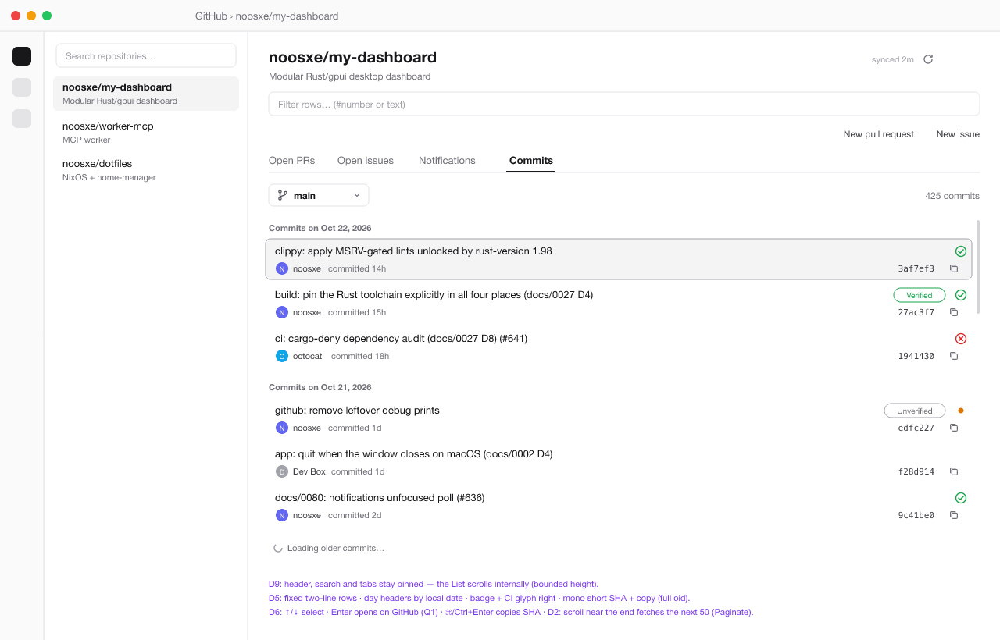

# 0081 — Repo View: Commits Tab (paginated history, day-grouped virtual list)

- **Issue:** (filed with the implementation issues after this doc merges)
- **Amends:** docs/0077 D1/D3/D6 (a fourth tab and lane), docs/0048 D4 (a
  `commits` trail key)
- **Interacts with:** docs/0031 (in-flight dedup), docs/0036 (backoff),
  docs/0037/0033 (freshness cluster), docs/0042 (shared quick filter),
  docs/0044 (`RepoBranches` source), docs/0047 (cursor "Load more"
  precedent), docs/0050/0053 (usage accounting), docs/0052 (refresh
  triggers), docs/0010 D10 + docs/0049 (ids, a11y), docs/0065 (UI gate),
  docs/0071 (containerized verification)

## 1 Summary

The open-repo view gets a fourth tab, **Commits**: the commit history of
the default branch, newest first, as GitHub shows it on
`/{owner}/{repo}/commits`. Rows are grouped under day headers
("Commits on Oct 21, 2026"). Each row shows the message headline, the
author's avatar and login, a relative time, a verification badge, the CI
rollup glyph and a copyable short SHA.

The list is the pinned gpui-component `List`, which is virtualized and
has sections, keyboard selection and load-more hooks. Its delegate pages
the GraphQL `history` connection with cursors as the user scrolls
(infinite scroll, 50 commits per page). Data is fetched only when the
user first lands on the tab, through a new `RepoLane::Commits` that rides
the docs/0077 lane machinery, so nothing is fetched for a hidden tab.

A branch selector ships in v1 (D7; the lane is keyed by `(repo, ref)`
from day one).

## 2 Verified facts (pinned sources, 2026-10-23)

1. **Tabs and lanes.** `RepoTab { Pulls, Issues, Notifications }` lives
   on `GithubPage` (`page.rs:43`) and maps to
   `RepoLane` (`service.rs:912`). A switch goes through `switch_repo_tab`
   (`page.rs:1270`). It records the docs/0048 visit, then offers
   `repo_lane_refresh_specs(full, lane, FOCUS_MIN_AGE, ViewShown)`
   (`service.rs:2773`). That gate checks the per-repo backoff and the
   lane's `rows_landed[(repo, lane)]` clock, and the docs/0031 dedup
   absorbs re-offers. Repo selection resets the tab to `Pulls` and fires
   that lane only (`page.rs:1252`).
2. **Refresh triggers.** The docs/0035 heartbeat is gone (docs/0052 D1).
   The automatic triggers left are view-shown (tab entry, crumb
   re-entry, return from a detail page) and window refocus
   (`refresh_open_page`, `page.rs:397`). The header's freshness cluster
   refresh button is `Trigger::Manual` and bypasses the age, backoff and
   dedup gates (`page.rs:2840–2862`).
3. **The cursor precedent.** `Kind::AccountPullRequests` (docs/0047) is
   the only cursor-paginated lane. "Load more" is an explicit button
   (`page.rs:873–891`, `load_more_home_prs` `page.rs:664`). Its spec
   carries `$after`, and `run_home_prs` copies the cursor into
   `SpecResult::cursor` so `apply` appends instead of replacing
   (`service.rs:4801`). The lane books are `HomeLane { order, total_count,
   complete, cursor }` (`service.rs:600–616`). It is triggered as
   `Trigger::Manual`.
4. **Repo-tab rows are not virtualized.** `repo_pulls_box` and
   `repo_issues_box` render up to 100 `div` rows into a `v_flex` inside a
   GroupBox (`page.rs:2995–3028`). The whole right column is one
   `div().id("repo-detail").overflow_y_scroll()` (`page.rs:2925–2931`).
   The rows are clickable `div`s with `Role::ListItem` and explicit
   `aria_label`s (`page.rs:1962–1979`). They have **no focus handle and
   no keyboard path**.
5. **The pinned `List` (gpui-component `1676826`).** `ListDelegate`
   (`crates/component/src/list/delegate.rs`) has `sections_count`,
   `items_count(section)`, `render_section_header` ("every header should
   have same height"), `render_item` ("every item should have same
   height"), `loading` / `render_loading`, `render_empty`, `confirm`,
   `has_more`, `load_more_threshold` (default 20 entities) and
   `load_more` (called near the bottom, "you must check if there is more
   data to load or lock the loading state"). `List`
   (`list/list.rs`) binds ↑/↓/Enter/Esc, renders `Role::List`, and gives
   each row `Role::ListItem` with `aria_position_in_set`,
   `aria_size_of_set` and `aria_selected` (`list.rs:496–499, 680`). It
   lays out `size_full()` on a `v_virtual_list`, so **it needs a
   bounded-height parent**. The repo list (`RepoListDelegate`,
   `page.rs:158/289`) is the in-module precedent.
6. **Widgets.** `Avatar::new().src(…).name(…)` (Sizable,
   `component/src/avatar/avatar.rs`). `Clipboard::new(id).value(…)
   .tooltip(…).accessibility_label(…)` (`component/src/clipboard.rs`).
   Remote avatar URLs resolve through the app's gpui HTTP client
   (`crates/app/src/main.rs:52`, `reqwest_client` in `Cargo.toml`).
   GraphQL nodes already fetch `author { login avatarUrl }`, but **no
   surface renders avatars yet**.
7. **GitHub schema** (`docs.github.com/public/fpt/schema.docs.graphql`,
   fetched 2026-10-23):
   - `Commit.history(after, before, first, last, author: CommitAuthor,
     path: String, since: GitTimestamp, until: GitTimestamp):
     CommitHistoryConnection!`, where the connection has `nodes`,
     `pageInfo` and `totalCount`;
   - `CommitAuthor { id: ID, emails: [String!] }` (the `id` is a User
     node id and takes precedence over `emails`);
   - `Commit` has `oid`, `abbreviatedOid`, `messageHeadline`,
     `committedDate`, `authoredDate`, `url`, `author: GitActor`,
     `signature: GitSignature`, `statusCheckRollup: StatusCheckRollup`;
   - `GitActor { avatarUrl(size), date, email, name, user: User }`;
   - `GitSignature { isValid, state: GitSignatureState,
     wasSignedByGitHub, … }` (`VALID`, `UNSIGNED`, `UNVERIFIED_EMAIL`,
     `INVALID`, …);
   - `StatusCheckRollup.state: StatusState!`, already tone-mapped by
     `gql::rollup_state` (`gql.rs:934`);
   - `Repository.defaultBranchRef: Ref`, `Repository.ref(qualifiedName)`,
     `Repository.object(expression, oid): GitObject`.
8. **Usage taxonomy.** `Trigger { Bootstrap, ViewShown, Refocus, Manual,
   Expand, MutationRefetch, Drift, Poll, Probe, Auth, … }`
   (`usage.rs:483`). There is no scroll or pagination trigger.
9. **Branch source.** `REPO_BRANCHES_QUERY` (`gql.rs:2504`) returns
   `defaultBranchRef { name }` plus up to 100 `refs/heads/` with a
   `query:` substring filter. It is page-owned and lazy (docs/0044
   D1/D4).
10. **Time helpers.** `dashboard_core::freshness::relative_age` returns
    the house compact form (`now` / `5m` / `3h` / `2d`,
    `core/src/freshness.rs:105`).

11. **Live receipts** (`gh api graphql` against `noosxe/my-dashboard`,
    2026-10-23). The `RepoCommits` shape with `first: 50` and the full
    `CommitRow` fragment billed `rateLimit.cost = 1` (425 commits,
    `hasNextPage: true`). `endCursor` is `"<tip oid> 49"`, an offset from
    the tip. Page 2 through `object(oid: <tip>) { history(after:) }`
    billed 1 point, returned the next 50, and ended at `"<tip> 99"`.
    `ref(qualifiedName: "HEAD")` returned `null`. `"main"` and
    `"refs/heads/main"` both resolve. An unsigned commit's `signature`
    is `null`, and an unlinked author's `user` may be `null`.

## 3 Goals

- G1: a fourth repo-view tab, **Commits**, showing default-branch history
  newest-first, with day headers and GitHub-style rows (§4 D5).
- G2: **lazy and view-relevant.** No commit request goes out until the
  tab is entered. After that the tab follows the docs/0077 lane rules
  exactly (view-shown / refocus / manual, age-gated, deduped, backed
  off).
- G3: **bounded cost.** Each page is one GraphQL request of about one
  point. Scrolling fetches only while the user scrolls, with a hard cap
  on held commits.
- G4: **keyboard- and screen-reader-complete** from day one (↑/↓/Enter,
  copy SHA reachable, row names announced).
- G5: designed loading, empty and error states, plus an honest tail
  ("end of history" vs. "cap reached").

## 4 Decisions

### D1: The tab and its lane

- `RepoTab::Commits` is appended **last**: Open PRs, Open issues,
  Notifications, Commits. Appending keeps the existing indices and trail
  keys stable. The label is "Commits". The docs/0048 trail key is
  `repo:<name>:commits`.
- `RepoLane::Commits` (slug `commits`) is added to `RepoLane`.
  `repo_lane_spec` maps it to `Kind::RepoCommits` for page 1 of the
  current ref. `rows_landed[(repo, Commits)]`, the per-repo backoff, the
  freshness cluster, and the `repo_rows_landed_any` agent view all take
  the new lane with no new mechanism.
- The fetch table follows docs/0077 D3. Entering the tab offers the lane
  (a first visit always fetches). Refocus and view-shown re-offer it
  behind `FOCUS_MIN_AGE`. The header refresh button sends it as
  `Trigger::Manual`. Repo open does **not** fetch commits. The
  mutation-refetch invalidation (docs/0077 D3) does **not** drop the
  commits clock, because no in-app write changes history.

### D2: Data: `RepoCommits` query, one page = 50

There are three query constants with one shared field fragment
(`COMMIT_ROW_FIELDS`), in the `gql.rs` style:

```graphql
fragment CommitRow on Commit {
  oid abbreviatedOid messageHeadline committedDate authoredDate url
  author { name email avatarUrl(size: 40) user { login } }
  signature { isValid state wasSignedByGitHub }
  statusCheckRollup { state }
}

# page 1, default branch: resolves the ref and pins the tip
query RepoCommits($owner: String!, $name: String!, $first: Int!) {
  rateLimit { cost remaining resetAt limit }
  repository(owner: $owner, name: $name) {
    defaultBranchRef {
      name
      target { ... on Commit { oid history(first: $first) {
        totalCount pageInfo { hasNextPage endCursor }
        nodes { ...CommitRow } } } }
    }
  }
}

# page 1, a picked branch (D7): the same body on ref(qualifiedName:)
query RepoCommitsRef($owner: String!, $name: String!, $ref: String!,
                     $first: Int!) {
  rateLimit { cost remaining resetAt limit }
  repository(owner: $owner, name: $name) {
    ref(qualifiedName: $ref) { name target { ... on Commit { oid
      history(first: $first) { totalCount pageInfo { hasNextPage endCursor }
        nodes { ...CommitRow } } } } }
  }
}

# page N: pinned to the tip oid page 1 resolved
query RepoCommitsMore($owner: String!, $name: String!, $tip: GitObjectID!,
                      $first: Int!, $after: String!) {
  rateLimit { cost remaining resetAt limit }
  repository(owner: $owner, name: $name) {
    object(oid: $tip) { ... on Commit { history(first: $first, after: $after) {
      pageInfo { hasNextPage endCursor } nodes { ...CommitRow } } } }
  }
}
```

- **Default ref in one round trip.** `defaultBranchRef` resolves the
  ref and its history in the same request, and its `name` labels the
  tab body (and the D7 selector). `ref(qualifiedName: "HEAD")` was tried
  and **returns `null`** (live receipt, §2 fact 11), so the default
  branch can't share the picked-branch query.
- **Tip pinning.** Load-more pages through `object(oid: $tip)`, not
  through the moving ref. A push during a scroll therefore can't shift
  the cursor's offsets (the cursor is literally `"<tip> <offset>"`, §2 fact 11) and duplicate or skip rows. New commits on the
  ref appear only through a page-1 revalidation (D4).
- **Page size 50** (`COMMITS_PAGE` knob). Each page is **one point**
  (measured, §2 fact 11): one `history` connection, and no nested
  connections in `CommitRow`. 50 rows is about three screens of
  rows, more than the List's `load_more_threshold` of 20 needs. It also
  keeps the per-page server time down: `statusCheckRollup` is the
  expensive field on large repos, and 100 doubles it. This is a knob, so
  the owner can tune it.
- **Hard cap: 1,000 held commits** (`COMMITS_HELD_CAP`, 20 pages). Past
  the cap, `has_more()` returns false and the tail row reads "Older
  history on GitHub ↗" (opens `…/commits/<ref>`). It is an honest cap,
  in the docs/0047 search-cap register.
- **No `associatedPullRequests` or co-authors in v1.** Both are nested
  connections. The point cost is still about one, but they add latency
  and a second avatar stack. Squash-merge headlines already carry
  `(#123)`. See Q4 and §7.

### D3: Store integration: a lane book on `GithubState`, not a document store

Commits are not PR/issue documents. They have no number and no detail
page in v1, and they are immutable apart from their CI rollup. So they
don't enter the docs/0072 store. A lane book holds them on `GithubState`,
like `HomeLane`:

```rust
pub(crate) struct CommitLane {
    pub ref_name: String,          // "main" (from the response)
    pub tip: String,               // pinned head oid (D2)
    pub rows: Vec<gql::CommitRow>, // newest-first; the only copy
    pub total_count: i64,          // history.totalCount at the tip
    pub cursor: Option<String>,    // endCursor for the next page
    pub complete: bool,            // !hasNextPage
    pub loading_more: bool,        // load_more lock (§2 fact 5)
    pub error: Option<String>,     // last page-N failure, tail-row retry
}
// keyed by (full_name, RefKey) — RefKey::Default | RefKey::Branch(name)
pub(crate) commit_lanes: HashMap<(String, RefKey), CommitLane>,
```

- **One copy.** The `List` delegate holds no rows. Like docs/0073 D3 it
  derives from the lane book each frame (the day sections plus the
  quick-filter view, §4 D6). It keeps only `(repo, RefKey)`, the
  selection index and the derived section index.
- **In memory only.** Nothing is persisted to the app DB or the cache
  files. On a cold start the tab shows skeleton rows until its first
  landing (docs/0051 D5 semantics). Persistence is a non-goal (§7).
- **Eviction.** The book survives repo switches, because the
  paint-before-fetch and stale-while-revalidate feel is the point. The
  number of books is bounded by an LRU of 8 `(repo, ref)` entries
  (`COMMIT_LANES_CAP`).

### D4: Revalidation: prepend-merge, never a page-1 collapse

The `HomeLane` precedent replaces the book on refresh (§2 fact 3), which
collapses everything the user scrolled through. For a 1,000-row history
that a refocus revalidates, replacing would throw the user back to the
top and refetch everything below. Instead, a **page-1 landing on a held
book**:

1. finds the held book's `tip` in the landed page;
2. if it is found at index *k*, prepends `landed[..k]` (the new
   commits), refreshes `statusCheckRollup` and `signature` on the
   overlapping rows `landed[k..]`, and keeps the held tail, cursor and
   `complete`. The new tip becomes the page-1 tip. Load-more keeps
   paging from the old tail cursor, which is still valid because the
   history below the old tip didn't change;
3. if it is not found (a force-push, or more than 50 new commits),
   **replaces** the book with page 1, resets the cursor, and scrolls to
   the top. The book gets a one-shot `rewritten` flag that renders a
   muted "History changed; showing the latest" line above the first
   section until the next landing.

The scroll position is anchored on the top-visible commit's oid, so
prepended rows don't jerk the viewport. That uses the `List`'s scroll
handle, the same anchor-by-identity idea as docs/0041's anchor cache.

### D5: Row anatomy (GitHub-style, house register)

Each row has a **fixed two-line height**, because `List` requires
uniform rows (§2 fact 5):

```
│ ⟨headline, truncated with ellipsis …………………………⟩     [✓ Verified] ⟨ci⟩ │
│ (◎) login  committed 3h                              a1b2c3d  ⧉ │
```

- **Line 1:** `messageHeadline` (`text_sm`, foreground, ellipsized).
  On the right, the verification badge, then the CI glyph. The badge is
  a small outline `Tag`: "Verified" (success tone) when
  `signature.isValid`; "Unverified" (muted) when a signature exists but
  is invalid; nothing when unsigned. That matches GitHub's default
  without vigilant mode. The CI glyph reuses `ci_row_glyph(rollup_state(…))`
  with its tooltip, so it is glyph plus text and never color alone
  (rubric 17).
- **Line 2** (`text_xs`, muted): `Avatar` at `xsmall` size (from
  `author.avatarUrl`; the placeholder is the `name` initial), then the
  login (`author.user.login`, falling back to `author.name` for
  unlinked emails), then "committed " plus `relative_age(committedDate)`
  with the absolute timestamp in the tooltip. On the right, the
  monospace `abbreviatedOid` and a `Clipboard`
  (`.value(oid)` with the **full** oid; tooltip "Copy full SHA";
  accessibility label "Copy SHA a1b2c3d").
- **Day headers:** "Commits on Oct 21, 2026", grouped by the **local**
  calendar day of `committedDate`, with a muted `text_xs` label and a
  fixed height. The sections are derived from the held rows each frame,
  so a day split across a page boundary merges as soon as the next page
  lands.
- **Spacing** follows the PR row: `px_2`, `py_1p5`, `rounded_sm`, a hover
  of `secondary`, and selected using the List's selected token. There
  are no borders between rows (rubric 15). Space and headers do the
  grouping (rubric 14).

### D6: Interaction, keyboard and a11y

- **Click / Enter** (`confirm`) opens the commit on github.com
  (`commit.url` → `cx.open_url`). This is the **v1 placeholder** pending
  Q1. Other v1 browser hand-offs (the files sidebar, the notification
  page) use the same `open_url`. Secondary-confirm (⌘/Ctrl+Enter) copies
  the full SHA. That is the keyboard path to the clipboard, because the
  copy icon itself isn't a separate tab stop inside a list row.
- **Keyboard:** the `List`'s own focus with ↑/↓/Enter/Esc. Tab from the
  tab strip lands on the list. This is new for the repo view, because
  the other tabs' rows aren't focusable (§2 fact 4, flagged F3).
- **A11y:** the list is `Role::List` with an accessible name of
  "Commits on <ref>". Rows are `Role::ListItem` with position-in-set,
  size-of-set and selected from the primitive, plus an explicit
  `aria_label` (docs/0049 D1) in reading order:
  `"<headline> — <login>, committed <relative>, <Verified|Unverified|>, <CI text>, <short sha>"`.
  Day headers are `Role::Heading` (level 3) with their text as the name.
- **Debug ids** (docs/0010 D10): `commits-list` (the List element),
  `commit-<oid12>` row selectors (`debug_selector`, the first 12 hex
  digits of the oid, unique and stable within a run),
  `commit-copy-<oid12>`, `commits-day-<yyyy-mm-dd>`, `commits-more`
  (the tail row), `commits-ref-select` (when D7 ships) and
  `commits-retry`.
- **Quick filter (docs/0042 D5).** The shared `repo-row-search` box
  filters the **loaded** commits by case-insensitive substring over the
  headline, login and short SHA, or by SHA prefix. While it is non-empty,
  `has_more()` returns false, so typing never chain-fetches history, and
  the tail reads "Filtering N loaded commits; clear to load more". See
  F2. There is no per-tab filter toolbar in v1 (Q3).

### D7: Branch/ref selector (ships in v1, Q2 resolved)

A compact `Select` sits left-aligned in the tab body header, above the
list. It shows the current ref name ("main" by default) and is searchable
over `RepoBranches` (`refs(query:)`, fetched lazily on the first open of
the selector, page-owned: the docs/0044 picker-source pattern). Picking
a branch sets the page's `commits_ref: RefKey`, which is session-local
and reset to `Default` on repo selection (like docs/0077 D1). It then
offers `RepoCommitsRef` for `(repo, RefKey::Branch(name))`. The lane clock
key widens to `(repo, Commits)` plus the ref, either as a sub-map on the
lane book or with `RefKey` folded into the `rows_landed` key, whichever
the implementation finds keeps `repo_lane_refresh_specs` smallest. Tags
and arbitrary SHAs are out of scope.

### D8: States

| State | Render |
| --- | --- |
| Never landed, in flight | 6 two-line skeleton rows under a skeleton day header (the `home_skeleton_rows` rhythm, through `ListDelegate::render_loading`) |
| Landed, empty history | `muted_cell("No commits on <ref>")` (this happens for an empty repo, where `ref` is null) |
| Page-1 error, nothing held | an inline error cell naming the cause, plus a **Retry** button (`commits-retry`, `Trigger::Manual`). Auth and rate-limit errors still route through the shared `apply` handling (pause chip, toasts) |
| Page-1 error, rows held | the rows stay (stale); the freshness cluster's label ages; no banner (docs/0034 mark-not-evict) |
| Load-more in flight | the tail row shows a small spinner and "Loading older commits…" (status visible, rubric 1) |
| Load-more error | the tail row shows "Couldn't load older commits: <cause>" plus **Retry** (`commits-more`); `loading_more` unlocks |
| Complete | the tail row "Beginning of history · N commits" (muted) |
| Cap reached | the tail row "Older history on GitHub ↗" (D2) |
| Filtered, no match | `muted_cell("No loaded commits match")` |

### D9: Layout: the Commits tab bounds its own height

`List` needs a bounded parent (§2 fact 5), but the right column is one
unbounded `overflow_y_scroll` div (§2 fact 4). A virtual list inside it
has no viewport, so it renders everything or nothing. **When the Commits
tab is active,** `repo-detail` therefore renders as a non-scrolling
`v_flex().size_full()`: the header, search, actions and tab strip are
pinned, and the list is `flex_1().min_h_0()` and scrolls internally.
The other three tabs keep today's column scroll unchanged (F1 discusses
unifying them).

### D10: Usage accounting

- `Kind::RepoCommits` (page 1) and its load-more pages ride the existing
  GraphQL runner (`run_graphql_fetch`) and the `CountingHttp` seam. That
  gives `rateLimit` reconciliation and usage records (docs/0050/0053)
  with no new code.
- `kind_name`: `repo-commits`. Origins: `Surface::RepoView` ×
  `ViewShown` / `Refocus` / `Manual`, and **`Trigger::Paginate`
  (new)** for scroll-driven pages (F4). The usage page then answers
  "what did scrolling commits cost" separately from "what did opening
  the tab cost".
- Load-more runs **outside** the docs/0031 per-key dedup (the docs/0047
  load-more precedent). The `loading_more` lock is the single-flight
  guard. It still respects the rate-limit pause gate: while the pause is
  active, `has_more()` returns false and the tail row says why.

## 5 Flagged patterns: what doesn't fit, with alternatives

The owner asked for these to be named, not silently deviated from.

### F1: The repo column is one scroll container; virtual lists need bounded height

- **Problem.** `repo-detail` wraps the header and the active tab in one
  `overflow_y_scroll` (`page.rs:2925–2931`). The Open PRs and issues
  boxes get away with it because they render at most 100 plain rows
  (`page.rs:2995–3028`). A paginated, virtualized history can't, because
  `List` lays out `size_full()` (`list.rs:547, 681`).
- **Evidence.** §2 facts 4–5.
- **Recommendation.** D9: the Commits tab pins the chrome and the list
  fills the remaining height. File a follow-up issue (`deferred`) to move
  all four tabs to the same pinned-header layout, with Open PRs and
  issues on `List` too. They have the same 100-row cap and no keyboard
  path (F3). Until then the tabs differ in one visible way: the header
  scrolls away on three tabs and stays pinned on Commits. That deviation
  is recorded here, not smuggled.

### F2: The 0042 filter engine is client-side, which lies on an unbounded list

- **Problem.** docs/0042 filters the *held* nodes (`filters::apply_prs`,
  `page.rs:2981`). That is honest for a 100-row snapshot with a cap
  hint. For a history of thousands of commits, a client-side author
  filter over the loaded 50 would read as "this author has 2 commits".
- **Evidence.** docs/0042 §3 fact 1 and D5; the schema facts
  (`history(author:, path:, since:, until:)` are **server-side**
  filters, §2 fact 7). GraphQL has no server-side message search.
- **Recommendation.** Structured filters (author, path, date range)
  become **server-side**: each one is part of the lane key and fetches a
  fresh paginated history. They are **not** docs/0042 toolbar chips. The
  shared text box stays client-side and is labeled as filtering
  *loaded* commits, with auto-paging disabled while it is active (D6).
  Whether any structured filter ships in v1 is Q3.

### F3: Repo-view rows have no keyboard path

- **Problem.** PR, issue and notification rows are clickable `div`s with
  no focus handle (`page.rs:1962–1979`), so the repo view can't be
  operated from the keyboard past the tab strip. That is a rubric-7
  and docs/0049 gap.
- **Recommendation.** Commits uses `List` and is keyboard-complete
  (D6). The existing tabs' gap is out of scope and **filed as its own
  issue**, not fixed here. It pairs naturally with F1's follow-up.

### F4: "Load more" is a Manual click; infinite scroll needs its own trigger

- **Problem.** The only paginated lane (home, docs/0047 D4) is an
  explicit button stamped `Trigger::Manual` (`page.rs:664–676`). The
  brief asks for infinite scroll. Stamping scroll-driven pages as
  `Manual` would make the usage page attribute passive scrolling to
  deliberate clicks. `Expand` means "opened a collapsed thing".
- **Evidence.** `usage.rs:483` (the closed `Trigger` enum, a required
  field, docs/0053).
- **Recommendation.** Add `Trigger::Paginate` to the closed enum, which
  is a compiler-enforced additive change, and use it for commits pages.
  Keep the home "Load more" button as `Manual`, because there it *is* a
  click. Infinite scroll is bounded by D2's cap and the rate-limit gate,
  so passive scrolling can't drain the budget: at most 20 points per
  repo and ref per session.

### F5: Page-1 refresh replaces the paginated book

- **Problem.** The home lane's refresh replaces the book and drops loaded
  pages (§2 fact 3). Copying that to commits would collapse a scrolled
  history on every refocus.
- **Recommendation.** D4 (prepend-merge on tip overlap, replace on a
  force-push). It is not retrofitted onto the home lane; that is a
  follow-up issue if the owner wants it.

### F6: docs/0077 says things the code no longer does

- **Problem.** docs/0077 D3/D4 still describe a heartbeat that
  refreshes the active lane. docs/0052 D1 deleted it (the code has only
  view-shown, refocus and manual triggers, `page.rs:397–402`). docs/0077
  D6 promises per-tab debug ids (`repo-tab-pulls`, …), but the pinned
  `Tab` derives ids from the bar and index, and the code says so
  (`page.rs:2934–2938`).
- **Recommendation.** This doc designs against the code: no heartbeat,
  and index-derived tab ids. The Commits tab is reached as the strip's
  fourth tab, and receipts click it by its index-derived id. A small
  docs-only fix to docs/0077 is **filed as an issue** rather than folded
  in, per README immutability ("substantive changes go into a new
  doc").

## 6 Open questions (owner)

- **Q1: Commit detail.** What does clicking a commit do?
  (a) open on github.com, the v1 default in D6; (b) an in-app commit
  page: headline, body, author/committer, parents, and the changed files
  through the existing docs/0070 Diff and Files-tab machinery, with
  REST `GET /repos/{o}/{r}/commits/{sha}` for the file list. Option (b)
  is a feature of its own and would get its own design doc. My
  recommendation is (a) now and (b) as a follow-up doc.
- **Q2: Branch selector.** Should D7 ship in v1? I recommend **yes**: it
  is cheap given the lane is ref-keyed and `RepoBranches` exists. The
  alternative is default branch only, with the selector as a follow-up.
- **Q3: Filters.** Which server-side filters ship in v1, if any:
  author ("mine" maps to the viewer's node id; other authors would need
  a user picker), path (a text input), since/until? I recommend
  **none in v1** beyond the loaded-text quick filter, with author="mine"
  as the first follow-up.
- **Q4: Associated PR chip.** Should each row show its merged PR
  (`associatedPullRequests(first: 1)`) as a `#123` chip that opens the
  in-app PR page? That adds a nested connection and latency. I recommend
  **not in v1**, because squash headlines already show `(#123)`.
- **Q5: Tab order.** Commits goes last (D1, for index stability), or
  after Open issues to match GitHub's emphasis? I recommend last.

### 6.1 Resolutions (owner, 2026-10-23)

- **Q1:** (a) is accepted. v1 opens the commit on github.com. The in-app
  commit page is a follow-up design doc (§7).
- **Q2:** yes. The ref selector (D7) ships in v1.
- **Q3:** none. v1 has no server-side filters, only the loaded-text quick
  filter (D6). Author="mine" is the first follow-up (§7).
- **Q4:** no associated-PR chip in v1 (§7).
- **Q5:** Commits is the last tab (D1).

## 7 Non-goals (filed as `deferred` issues before implementation merges)

- An in-app commit detail page (Q1(b); its own design doc).
- Server-side author, path and date filters (Q3 follow-ups).
- Associated-PR chips and co-author avatar stacks (Q4).
- Tags or arbitrary-SHA history, compare views, and blame.
- Persisting commit books to the app DB across restarts.
- Moving Open PRs, issues and notifications onto `List` with pinned
  chrome (F1/F3).
- Prepend-merge for the home lane (F5).
- Correcting docs/0077's heartbeat and tab-id text (F6).

## 8 Testing and verification

**Unit (service.rs / gql.rs / page.rs):**

- Lane map: entering Commits offers `RepoCommits` exactly once; repo open
  doesn't; a fresh-lane re-entry is gated; refocus re-offers after
  `FOCUS_MIN_AGE`; manual bypasses age, backoff and dedup.
- Parse: `CommitRow` fixtures for signed-valid, unsigned, invalid,
  unlinked-email author (`user: null`), null rollup, and empty-repo
  (`ref: null`) cases.
- Pagination: page N appends and keeps order; `complete` stops
  `has_more`; the `loading_more` lock refuses re-entry; the cap stops at
  1,000; a page-N error keeps the rows and sets the tail error; the
  quick filter disables `has_more`.
- Revalidation (D4): tip found at k=0 is a no-op merge with refreshed
  rollups; k=3 prepends 3 and keeps the tail and cursor; tip absent
  replaces and sets `rewritten`.
- Sectioning: a local-day grouping fixture that crosses midnight and a
  page boundary; header labels; stable section indices after an append.
- The a11y label builder (reading order, the unsigned and no-CI
  omissions).
- Usage: page 1 records `ViewShown`/`Manual`, scroll pages record
  `Paginate`; `kind_name` is `repo-commits`.

**Bridge (docs/0010 / docs/0055), in the docs/0071 container:**

- New receipt `crates/debug/verify/repo-commits.txt`: start a session,
  open a repo, `tree` (assert no `commit-*` nodes and no commits flight
  in `logs`), click the fourth tab, `wait-frame`, assert `commits-list`,
  day headers, and `commit-*` rows with labels; `key down` / `key enter`
  (a `logs` line for the open); scroll to the bottom → assert
  `Paginate` in `logs` and the row count grew; type in `repo-row-search`
  → assert the tail text and no further flights.
- `dashboard-debug audit` over the repo view on the Commits tab, plus
  `tree --tab-stops` (the list is one tab stop reachable from the strip).
- **Structural golden:** `snapshots/github.json` **will drift** (a
  fourth tab). Re-capture it with the drift explained. Add a new golden
  `snapshots/github-commits.json` captured on the Commits tab against a
  fixture-backed repo.
- **0065 D7 critique** before/after (the before is the three-tab view,
  the after is the Commits tab), max 3 iterations, findings in the PR.
- **Anchor (D8):** **Linear** for list-dense restraint (rows, day
  headers, muted metadata), with **Zed** (provisional) as the dev-tool
  register. The gpui-component `story` List and Avatar panels are the
  widget anchor. A noted deviation: GitHub's own commits page is the
  *content* reference (anatomy), not a visual anchor.

## 9 Implementation plan (issues filed after this doc merges)

1. **Data** (**shipped**, #646; see §11): `RepoLane::Commits`,
   `Kind::RepoCommits` plus the more query (D2 shapes, live-verified in
   §2 fact 11), `CommitLane`
   book, prepend-merge, `Trigger::Paginate`, unit tests.
2. **UI:** `RepoTab::Commits`, the `CommitsDelegate` (`List` sections,
   rows, states), the D9 layout, the copy SHA, the a11y and ids, the
   receipt, the goldens and the 0065 receipts.
3. The ref selector (Q2 resolved: ships in v1) over `RepoBranches`, with
   `RefKey`-keyed books.

## 11 Implementation notes (stage 1, #646, 2026-10-23)

The data layer shipped as designed, with these refinements. They are
recorded here because docs must match shipped behavior.

- **Two kinds, two op names.** `Kind::RepoCommits` covers both page-1
  shapes; the spec's `ref` variable picks `RepoCommitsRef`.
  `Kind::RepoCommitsMore` is page N. Usage records name them
  `repo-commits` and `repo-commits-more` (D10 had one name), so the
  usage page splits tab entries from scroll pages on the op as well as
  the trigger. Load-more therefore has its own docs/0031 in-flight key,
  and the book's `loading_more` lock remains the single-flight guard.
- **`CommitLane` fields** (D3) also carry `page_tip` (the tip the cursor
  was minted against; a prepend moves `tip` while the tail keeps paging
  `page_tip`'s chain, because the cursor is `"<tip> <offset>"`), a
  split `error` (page 1) / `more_error` (page N), and `landed:
  Option<Instant>` (`None` = never landed). A failed page 1 with nothing
  held creates a never-landed book carrying the error, for D8's inline
  error and Retry.
- **D4 overlap check.** A prepend-merge needs the held tip in the page
  **and** the overlap after it to match the held rows oid for oid.
  History isn't strictly append-at-head: merging a side branch can
  interleave older commits below the old tip, which a merge would miss.
  Any disagreement replaces the book, the same as a force-push.
- **Stale pages.** The run arm echoes `$after` back. A load-more whose
  cursor no longer matches the book (a replace landed while it flew)
  is dropped.
- **Clocks.** Only the default ref's landing stamps
  `rows_landed[(repo, Commits)]` (the freshness cluster and the agent
  view read it). Per-ref freshness for picked branches belongs to stage
  3 (#648), which reads the book's own `landed`.
- **Backoff.** Page-1 results bump the per-repo rows backoff (the page's
  run arm). Load-more failures don't, because their retry is the user's
  (D8).
- **Rate-limit gate.** `commits_more_spec` returns `None` while
  `gated()`, and a body's `rateLimit.remaining <= 0` arms the pause as
  on the other GraphQL lanes.
- **Live receipt** (2026-10-23): the shipped `REPO_COMMITS_QUERY`,
  `REPO_COMMITS_MORE_QUERY` and `REPO_COMMITS_REF_QUERY`, run verbatim
  against `noosxe/my-dashboard`, each billed `rateLimit.cost = 1` and
  returned 50 rows. Page 2 continued from `"<tip> 49"` to `"<tip> 99"`.

## 10 Mockup



Mockup source: [`assets/0081-commits-tab.svg`](assets/0081-commits-tab.svg).
It shows the Commits tab active with the ref selector (D7),
two day groups, signed, unsigned and CI-failing rows, a selected row with
the copy affordance, and the load-more tail. The colors are illustrative
neutrals; the implementation uses theme tokens only.
