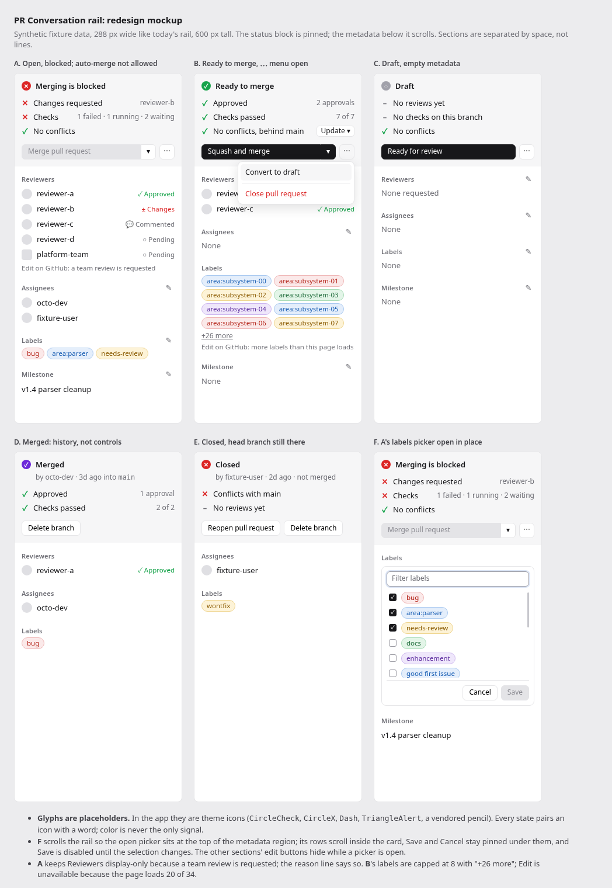

# 0083 — PR page: Conversation rail redesign (status block + compact metadata)

- **Date:** 2026-11-14
- **Issue:** #798 (part of the PR view fixes epic #730). Implementation issues
  are filed after this doc merges (§8).
- **Absorbs:** #732, #741, #754, #756, #799, #800. **Gives a home to:**
  #770–#776 (each still ships in its own issue).
- **Amends:** docs/0016 D5 (the merge/close panel becomes the status block)
  and its 2026-09-04 layout note; docs/0043 D3 (reason lines), D5 (order and
  section shape), D8 (ids) and §6; docs/0066 D3 (the rail's checks line
  becomes a gate row); docs/0067 D1 and D5 (Update branch moves into a gate
  row).
- **Keeps:** docs/0016 D5 gating (#708/#737) and the Merge/Close confirm
  (#738); docs/0043 D1, D2, D4, D6, D7 (writes, refetch, gates, shared
  picker machinery, one editor at a time, Esc order); docs/0072/0073 (one
  store, store-scoped pending writes); docs/0052 (no timers; the UNKNOWN
  re-poll of docs/0016 §15 stays the only exception).
- **Mockup:** [`assets/0083-pr-rail-redesign.png`](assets/0083-pr-rail-redesign.png),
  source [`assets/0083-pr-rail-redesign.html`](assets/0083-pr-rail-redesign.html).

## 1. Summary

The Conversation tab's right rail has to answer one question first: *can
this pull request merge, and if not, why?* Today the answer is spread over a
coloured sentence at the top, a checks card at the bottom (usually below the
fold, because the rail can't scroll, #732), and review outcomes that appear
nowhere (#741). The metadata panels below it waste space (#800), stack
labels as full-width bars (#799), cap lists without saying so (#754) and
have picker bugs (#756).

The redesign splits the rail into two regions:

1. A pinned **status block**: one verdict, up to three gate rows that say
   why (reviews, checks, mergeability), and one action row with a single
   primary action that fits the PR's state, plus a `⋯` menu for the rest.
2. A **scrolling metadata region**: Reviewers, Assignees, Labels and
   Milestone as flat sections separated by space, with compact rows,
   one-line empty states, caps that say they are capped and pickers that
   open in place.



The mockup shows six states over synthetic fixture data: **A** open and
blocked, **B** ready to merge with the `⋯` menu open, **C** a draft with no
metadata, **D** merged, **E** closed with its head branch still present,
**F** state A with the labels picker open. Glyphs in the mockup are
placeholders for theme icons (D15).

## 2. Decisions already made (2026-11-06)

- Section order: **Reviewers, Assignees, Labels, Milestone**.
- Edit controls are **hidden on merged and closed PRs**.
- Merge and Close confirm (shipped in #738). **Close moves into the `⋯`
  menu.**
- All missing PR actions (#770–#776) are in scope; this design gives each
  one a place. Implementation stays in their own issues.
- #732 (the rail can't scroll) is fixed by this redesign, not patched
  first.

Settled in review of this doc (2026-11-14):

- **No hairlines** between metadata sections; space alone separates them
  (D7).
- **The empty Milestone section stays visible on open PRs**, also for
  viewers who can't edit it. On merged and closed PRs, empty sections are
  left out (D6, D10).
- **Confirms:** Convert to draft, Delete branch, Enable auto-merge and
  Merge when ready confirm. Ready for review, Reopen, Disable auto-merge
  and Remove from queue don't, because each is undone in one click (D4,
  D5).
- **Blocked with auto-merge allowed:** the primary is "Enable auto-merge ▾"
  rather than a disabled Merge (D4).
- **Closed PRs** show Reopen and Delete branch side by side, with no `⋯`
  menu (D4, D5).
- **Team review requests** keep Reviewers display-only, with the reason
  line (D7, D8). Re-posting a team request through `requestReviews` could
  notify the team again.

## 3. Verified facts

Everything named here was checked on 2026-11-14 against GitHub's live
GraphQL schema (introspection) and, where behaviour matters, against live
public data. gpui-component facts are from the rev pinned in `Cargo.lock`
(`39ab849`, v0.9.1).

### 3.1 GraphQL

| Field / mutation | Where | Notes |
|---|---|---|
| `reviewDecision` | `PullRequest` | `PullRequestReviewDecision`: `APPROVED`, `CHANGES_REQUESTED`, `REVIEW_REQUIRED`; `null` when no review rule applies. |
| `latestOpinionatedReviews(first:)` | `PullRequest` | Latest review per user, **approvals and change requests only**. Checked on live data: a user whose latest review only commented is absent here. |
| `latestReviews(first:)` | `PullRequest` | Latest review per user that is not pending, **including** `COMMENTED`. Used to show commenters. |
| `reviewRequests` | `PullRequest` | `requestedReviewer` is the `RequestedReviewer` union: `User` (`id login avatarUrl`), `Team` (`id name avatarUrl`), `Bot` (`id login avatarUrl`), `Mannequin` (`id login avatarUrl`), `EnterpriseTeam` (`id name`, no avatar). |
| `PullRequestReviewState` | enum | `PENDING`, `COMMENTED`, `APPROVED`, `CHANGES_REQUESTED`, `DISMISSED`. |
| `mergeStateStatus`, `mergeable` | `PullRequest` | As docs/0016 D5 (allowlist `CLEAN`, `HAS_HOOKS`, `UNSTABLE`). |
| `statusCheckRollup.contexts.checkRunCountsByState`, `statusContextCountsByState` | `StatusCheckRollupContextConnection` | `{ state count }` lists. Exact counts even when the 100-node page is capped (fixture 102 has 137 checks). |
| `merged`, `mergedAt`, `mergedBy { login }` | `PullRequest` | `mergedBy` is an `Actor`. |
| `closedAt` | `PullRequest` | No `closedBy` field exists. The closer is `timelineItems(last: 1, itemTypes: [CLOSED_EVENT]) { nodes { ... on ClosedEvent { actor { login } createdAt } } }`, checked on live data. |
| merge method of a merged PR | — | **Not exposed.** Only `autoMergeRequest.mergeMethod` carries a method. The merged line says who, when and into which base, never "how". |
| `headRef { id }`, `viewerCanDeleteHeadRef`, `deleteRef(refId)` | `PullRequest`, `Mutation` | `headRef` is null once the branch is gone. The schema's description of `viewerCanDeleteHeadRef` says "restore the deleted head ref", so #773 must confirm its meaning on fixtures and live data before relying on it. |
| `viewerCanReopen`, `reopenPullRequest` | `PullRequest`, `Mutation` | #770. |
| `markPullRequestReadyForReview`, `convertPullRequestToDraft` | `Mutation` | Input is `pullRequestId` only. No dedicated viewer flag; `viewerCanUpdate` is the gate (#771, #772). |
| `autoMergeRequest { enabledBy { login } enabledAt mergeMethod }`, `viewerCanEnableAutoMerge`, `viewerCanDisableAutoMerge`, `enablePullRequestAutoMerge`, `disablePullRequestAutoMerge` | `PullRequest`, `Mutation`; `Repository.autoMergeAllowed` | #774. |
| `isInMergeQueue`, `mergeQueueEntry { position state }`, `Repository.mergeQueue(branch:)`, `enqueuePullRequest`, `dequeuePullRequest` | | `MergeQueueEntryState`: `QUEUED`, `AWAITING_CHECKS`, `MERGEABLE`, `UNMERGEABLE`, `LOCKED`. #775. |
| `Repository.viewerDefaultMergeMethod` | `Repository` | "The last used merge method by the viewer or the default for the repository." #776. |
| `viewerCanMergeAsAdmin` | `PullRequest` | Exists; admin bypass stays out (#821). |

### 3.2 gpui-component (pinned rev)

- **`DropdownButton`** (`button/dropdown_button.rs`) is a split button: an
  action `Button` plus a menu trigger. Disabling the *inner* button
  disables only the action half; the caret stays usable unless the whole
  `DropdownButton` is disabled. `menu_accessibility_label` names the caret.
  So a blocked Merge can stay disabled while the method can still be
  chosen.
- **`PopupMenu`** has `separator()` and `item(..)`. The probe-visible row
  pattern (`PopupMenuItem::element` with a `debug_selector`) is the one
  the update-branch menu already uses.
- **Scrolling:** `overflow_y_scroll()` + `track_scroll(&ScrollHandle)` and
  the `vertical_scrollbar(&handle)` helper (`scroll/scrollable.rs`).
- **Icons:** `CircleCheck`, `CircleX`, `CircleAlert`, `TriangleAlert`,
  `Dash`, `Minus`, `Ellipsis`, `LoaderCircle` and `User` are in the bundled
  icon set (`assets/default-icons.txt`). **`pencil`, `git-merge`,
  `git-pull-request-closed` and `git-pull-request-draft` are not.** The
  implementation vendors the ones it uses under `crates/app/assets/icons/`
  and serves them the way `git-branch.svg` is served (docs/0081).

## 4. Design

### D1 — Layout: two regions, one column

```
┌ rail, 288 px (w_72), height = the split ┐
│ STATUS BLOCK          pinned, flex_none │  verdict · gate rows · action row
│                                         │  confirms open here, in place
├─────────────────────────────────────────┤
│ rail error slot       pinned, optional  │  ErrorScope::Rail (docs/0043 D2)
├─────────────────────────────────────────┤
│ METADATA              flex_1, min_h_0,  │  Reviewers · Assignees ·
│                       overflow_y_scroll │  Labels · Milestone
│                       + scrollbar       │
└─────────────────────────────────────────┘
```

- **Width stays 288 px** (`w_72`). Narrow windows are a non-goal (§10).
- **Height:** the rail becomes `h_full()` inside the conversation split,
  like the timeline. The 2026-09-04 note in docs/0016 D5 chose
  `items_start` so the rail would hug its content, because cross-axis
  stretch pushed the stacked panels down. With an inner scroll region
  that's no longer an issue. The rail's column is top-aligned
  (`justify_start`), the status block is `flex_none`, and only the
  metadata region grows (`flex_1().min_h_0()`). The split keeps
  `items_start`, and both children set `h_full`.
- **Pinned status block:** it never scrolls, so the primary action and the
  verdict are always visible, even on a short window. Its height is
  bounded by content: the verdict, an optional sub-line, at most three
  gate rows, an optional inline confirm and one action row. That is about
  190 px at most, or about 260 px with a confirm open.
- **Metadata region:** its own `ScrollHandle` (`rail_scroll`) with a
  vertical scrollbar. It scrolls independently of the timeline. Its
  position survives refetches and is reset only when another PR opens.
- **One flat column**, no `GroupBox`. One helper builds every metadata
  section (`rail_section(title, edit, body)`, D7). The four
  near-identical `render_*_panel` functions go away.

### D2 — The verdict

The first line of the status block is an icon and a word or two in the
foreground colour, `font_semibold`. Only the icon is tinted. That fixes the
amber-text contrast problem #797 describes, because the words are no longer
tinted. The first matching row wins:

| # | Condition | Icon (tone) | Verdict |
|---|---|---|---|
| 1 | `merged` | merged glyph (the header's Merged tone) | **Merged** |
| 2 | `state == CLOSED` | `CircleX` (danger) | **Closed** |
| 3 | `isDraft` | `Dash` in a circle (muted) | **Draft** |
| 4 | `isInMergeQueue` | `LoaderCircle` spinner (warning) | **Queued to merge** |
| 5 | `autoMergeRequest` present | `LoaderCircle` spinner (warning) | **Auto-merge enabled** |
| 6 | `mergeable == CONFLICTING` or `mergeStateStatus == DIRTY` | `CircleX` (danger) | **Conflicts** |
| 7 | `mergeStateStatus == UNKNOWN`, or `mergeable == UNKNOWN`, or absent | `LoaderCircle` spinner (muted) | **Checking…** |
| 8 | `BLOCKED` | `CircleX` (danger) | **Merging is blocked** |
| 9 | `BEHIND` | `TriangleAlert` (warning) | **Out of date** |
| 10 | `UNSTABLE` | `TriangleAlert` (warning) | **Mergeable, checks failing** |
| 11 | `CLEAN`, `HAS_HOOKS` | `CircleCheck` (success) | **Ready to merge** |
| 12 | any other value | `CircleAlert` (muted) | **Merge status unknown** |

Rules:

- A **sub-line** (muted, `text_xs`) appears under the verdict only when it
  adds something: rows 1, 2, 4 and 5 (D6, D4). It never repeats the header.
- The verdict is pure: `rail::verdict::verdict(&PrDetail) -> Verdict`,
  table-tested, one arm per row. Row 7 keeps the docs/0016 §15 re-poll.
- The verdict replaces the docs/0016 D5 **state line**. Its full sentences
  move into the verdict's tooltip and the a11y description, so nothing is
  lost. The verdict is also the disabled Merge button's tooltip (#708),
  joined with the failing gate rows: "Merging is blocked: changes requested,
  1 check failed".

### D3 — Gate rows: why, and where to go

Below the verdict there are up to three rows in a fixed order: **Reviews,
Checks, Mergeability**. Each is an icon, a short label and an optional
right-aligned muted value (`text_xs`). A row that has somewhere to go is a
button-like row: it gets hover, focus ring, `Role::Link` and its own
a11y name. One that doesn't is a plain content node (docs/0049).

**Reviews** (data: `reviewDecision`, `latestOpinionatedReviews`,
`reviewRequests`):

| Condition | Icon | Label | Value |
|---|---|---|---|
| `CHANGES_REQUESTED` | `CircleX` danger | Changes requested | the requester's login, or "N reviewers" |
| `REVIEW_REQUIRED` | `TriangleAlert` warning | Review required | "N pending" when requests exist |
| `APPROVED` | `CircleCheck` success | Approved | "N approvals" |
| `null`, a change request exists | `TriangleAlert` warning | Changes requested | as above (doesn't block) |
| `null`, approvals exist | `CircleCheck` success | Approved | "N approvals" |
| `null`, nothing | `Dash` muted | No reviews yet | "N pending" when requests exist |

Activating the row scrolls the timeline to the newest review behind the
row's state (the newest change request, else the newest approval), using
the docs/0026 D9 anchor. If there is no such review, the row is not
interactive. If the review is outside the newest-100 window (docs/0016
§14), the anchor gives up quietly, as it does for notifications.

**Checks** (data: the rollup `state`, the two counts-by-state lists, and the
docs/0066 gated-run sweep):

- The counts fold into the same buckets the Checks tab uses (docs/0016 D7):
  failed, running/queued, passed (success, neutral, skipped), plus
  `waiting` from the gated sweep. The value lists the non-zero buckets that
  aren't passing, most urgent first: "1 failed · 1 running · 2 waiting".
  When everything passed it reads "7 of 7".
- Icon and label: any failure → `CircleX` danger "Checks"; else any running
  or waiting → spinner (warning) "Checks"; else all passed → `CircleCheck`
  "Checks passed"; no rollup and no waiting runs → `Dash` muted "No checks
  on this branch". This replaces the misleading "Checks status unknown" for
  a PR without checks (#798 item 12). "Checks status unknown" stays only
  for a payload that lacks the rollup field (degraded parse).
- Activating it opens the **Checks tab**, where the waiting runs' Review
  approval panel lives (docs/0066 D3). This row replaces the bordered
  checks card and its "View checks" / "Review approval" button.

**Mergeability** (data: `mergeable`, `mergeStateStatus`,
`viewerCanUpdateBranch`, `baseRefName`):

| Condition | Icon | Label | Trailing |
|---|---|---|---|
| conflicts (row 6 of D2) | `CircleX` danger | Conflicts with `<base>` | "Resolve on GitHub" link (opens the PR's conflicts page) |
| `BEHIND` | `TriangleAlert` warning | Out of date with `<base>` | **Update ▾** when `viewerCanUpdateBranch` |
| no conflicts, `viewerCanUpdateBranch` | `CircleCheck` success | No conflicts, behind `<base>` | **Update ▾** |
| no conflicts | `CircleCheck` success | No conflicts | — |
| unknown | spinner muted | Checking for conflicts | — |

- **Update ▾** is the docs/0067 split button, made small and moved here
  from its own row: the main click updates with a merge commit, and the
  caret offers both methods. It's built from the upstream `DropdownButton`,
  which also gives #748 its working main click and named menu items.
- The **rebase confirm** (docs/0067 D4) opens inline directly under this
  row, not above the Merge button.
- The row is hidden on merged PRs (the question no longer applies). On
  closed PRs it shows only conflicts.

### D4 — The action row: one primary action per state

The last line of the status block. The primary control fills the row; the
`⋯` button (`Ellipsis`, ghost, 26 px square) sits at its trailing edge
whenever the menu has at least one item (D5). The visibility rules of
docs/0016 D5 still hold: a control the viewer can't use is **hidden**; a
control the PR state blocks is **disabled**, with the reason as its tooltip.

| PR state | Primary | Notes |
|---|---|---|
| Open, mergeable (D2 rows 10–11) | **`<Method verb>`** split button, e.g. "Squash and merge ▾" | The caret lists the allowed methods with a check on the current one. The default is `viewerDefaultMergeMethod` when allowed, else the first allowed (#776). With one allowed method, it's a plain button and there's no caret. Click → the Merge confirm (#738). |
| Open, blocked/behind/conflicts/unknown, viewer can enable auto-merge (`autoMergeAllowed` and `viewerCanEnableAutoMerge`) | **Enable auto-merge ▾** | Same caret. Click → a confirm: "Enable auto-merge with squash? It merges once the requirements pass." (#774) |
| Open, blocked/behind/conflicts/unknown, no auto-merge | **`<Method verb>` ▾**, action half **disabled** | Tooltip from D2. The caret stays usable (§3.2). |
| Open, base branch has a merge queue (`Repository.mergeQueue(branch: base)` present), not queued | **Merge when ready ▾** | Confirm → `enqueuePullRequest` (#775). A queue runs the required checks itself, so #775 settles which `mergeStateStatus` values may enqueue; until then the Merge gate applies. |
| Queued (`isInMergeQueue`) | **Remove from queue** (secondary) | Sub-line: "Position N · <entry state>". No confirm: re-queueing is one click away (#775). |
| Auto-merge enabled | **Disable auto-merge** (secondary) | Sub-line: "by `<login>` · squash". Shown when `viewerCanDisableAutoMerge`. No confirm (#774). |
| Draft | **Ready for review** (primary) | Gate `viewerCanUpdate`. No confirm: it is reversible from the `⋯` menu (#771). |
| Merged | **Delete branch** (secondary) | When `headRef` is present and the viewer can delete it. Confirm (#773). |
| Closed | **Reopen pull request** (secondary) and **Delete branch** (secondary) | Reopen when `viewerCanReopen` (#770), no confirm. Delete branch as for merged. |
| Viewer can do none of these | no action row | The verdict and gates still show. |

The first matching row applies, in this order: merged, closed, draft,
queued, auto-merge enabled, merge queue present, mergeable, auto-merge
possible, blocked. A row whose control the viewer can't use falls through
to the next one. If none is left, the action row is omitted.

- While a write is pending (docs/0072 D4), the primary, the caret and `⋯`
  disable. The primary reads "Working…" with a spinner (the current
  "working…" wording, capitalised), and the tooltip is "Working".
- A merge, close or action error shows in the status block, directly under
  the action row (the current `panel_error` slot). Metadata errors use the
  rail error slot (D13).
- The method `Select` row is gone. The method lives in the split button's
  caret, which also fixes #768's unlabeled merge-method combo box: the
  caret's a11y name is "Choose merge method".

### D5 — The `⋯` menu and confirms

The `⋯` menu holds the actions that are not this state's primary:

| PR state | Items, top to bottom |
|---|---|
| Open, not a draft | Convert to draft · *separator* · Close pull request (danger tone) |
| Draft | Close pull request (danger tone) |
| Merged, closed | no menu |

- An item the viewer can't use is left out. A menu with no items hides the
  `⋯` button.
- **Convert to draft** (#772) and **Close pull request** confirm. **Delete
  branch**, **Enable auto-merge** and **Merge when ready** confirm too. All
  confirms use the docs/0016 D5 state machine (`pr_page/merge_confirm.rs`):
  one inline confirm at a time (the rebase confirm included), shown in
  place of the action row, re-checked against the gate when confirmed and
  closed by itself when the gate shuts. Esc cancels it (docs/0043 D7
  order). The machine grows `ConfirmKind` variants, and each confirm says
  what will happen in one sentence and names the target. For example:
  "Convert to draft? Reviewers won't be notified of new pushes until it is
  ready again." / "Delete branch `feature/x`?"
- Confirming focuses the confirm button; cancelling returns focus to the
  control that opened the confirm (`⋯` or the primary).

### D6 — Terminal states: history, not controls

Merged and closed PRs show what happened instead of repeating the header
(#798 item 10):

- **Merged:** verdict "Merged"; sub-line "by `<mergedBy>` · `<age of
  mergedAt>` into `<base>`" (base in mono). The gate rows show the final
  Reviews and Checks outcomes; Mergeability is hidden. Action: Delete
  branch (D4).
- **Closed:** verdict "Closed"; sub-line "by `<closer>` · `<age of
  closedAt>` · not merged" (closer from the `CLOSED_EVENT` timeline item,
  §3.1; without it the sub-line drops the "by" part). Gate rows: Reviews,
  Mergeability (conflicts only). Actions: Reopen, Delete branch.
- Metadata on terminal PRs: **no Edit controls** (§2). A section with
  nothing to show is **left out** rather than reading "None" (mockup D,
  E), because there's nothing to act on.

### D7 — Metadata sections: shared rules

Each section is `rail_section(title, edit, body)`:

- **Title row:** 20 px high. The title is `text_xs`, `font_medium`,
  `muted_foreground`, sentence case, no colon. The trailing **edit
  button** is ghost, xsmall and icon-only (vendored pencil), and its
  tooltip and a11y name both name the target: "Edit reviewers", "Edit
  assignees", "Edit labels", "Edit milestone" (#768). Titles are quieter
  than values (#798 item 8, Appendix A items 11–12).
- **Rhythm:** 2 px from the title row to the body; 4 px between rows inside
  a section; 16 px between sections; 12 px horizontal padding, shared with
  the status block. There are **no hairlines** between sections. In the
  mockup, space alone separates them (Appendix A item 15). The status block
  is set off by its background, not a border.
- **Order:** Reviewers, Assignees, Labels, Milestone (§2).
- **Edit visibility.** The edit button **shows** only when all of these
  hold:
  - the PR is open (§2);
  - the docs/0043 D4 viewer gate holds;
  - the docs/0043 D3 arming guards hold;
  - nothing is busy (no `busy` op and no store-pending write; #756);
  - no editor is open (docs/0043 D7).

  Otherwise it is **hidden**, never disabled.
- **Reason lines (#754).** When the edit button is hidden by a docs/0043
  D3 data guard rather than the viewer, the state or a transient busy
  flag, the section ends with one muted `text_xs` line that names the
  reason and the way out:
  - truncated connection → "Edit on GitHub: this page loads 20 of 34
    labels";
  - a team, bot or other non-user review request → "Edit on GitHub: a team
    review is requested";
  - an entry without an id → "Edit on GitHub: an entry couldn't be read".

  Permission-hidden and terminal-hidden edits stay silent, as on
  github.com. Busy or editor-open hiding is transient and also silent.

### D8 — People rows: Reviewers and Assignees

- **Row:** 26 px; avatar (18 px, `xsmall`), name, and for reviewers a
  right-aligned state. The name truncates with an ellipsis and shows the
  full name in a tooltip.
- **Reviewers** merge three sources into one list, one row per reviewer:
  - `latestOpinionatedReviews`: Approved or Changes requested (or
    Dismissed);
  - `latestReviews`: Commented, for users with no opinionated review;
  - `reviewRequests`: Pending, for anyone requested who hasn't reviewed
    since, plus teams.

  Dedupe by login (teams by id). A re-request after a review shows
  **Pending**, as on github.com. The order is: changes requested,
  approved, commented, pending, dismissed; then by login. The PR author
  never appears (#741).
- **Review state** = icon + word, tone on the icon only: `CircleCheck`
  "Approved" (success), `CircleX` "Changes" (danger), a muted comment icon
  "Commented", a muted `Dash` "Pending", a muted `Minus` "Dismissed".
- **Teams and other requested reviewers:** `Team` and `EnterpriseTeam`
  show their `name` with a **square** avatar (`Team.avatarUrl`, or the
  placeholder when absent, as for `EnterpriseTeam`); `Bot` and `Mannequin`
  show `login` with their avatar. "team or bot" goes away (#741).
- **Assignees:** avatar + login rows, unchanged in content.
- **Caps:** 8 rows are visible. Beyond that, a "+N more" row (ghost
  button, `text_xs`) expands the section to everything fetched. If the
  connection's `totalCount` exceeds what was fetched (`first: 20`), the
  expanded list ends with the shared `cap_row` "+N more on GitHub" (docs/0016
  §12), which opens the PR upstream. The expansion is page state and resets
  when another PR opens.
- **Loaded pages:** each of the three sources loads 20 nodes. The two
  review lists hold the latest review per reviewer, so 20 covers a normal
  PR; beyond that the rows show what the requests add. The "+N more on
  GitHub" count comes from the requests connection only.
- **Glyph:** the "Commented" icon is the vendored octicon `comment-16`
  (`icons/comment.svg`), since the bundled set has no comment icon.
- **Empty:** Reviewers "None requested", Assignees "None" (D11).

### D9 — Labels

- Pills **hug and wrap** in one `h_flex().flex_wrap().gap_1()` container
  that holds the pills themselves (#799). The pill builder stays
  `page::label_pill` (docs/0002 D5 data-colour exception).
- **Caps:** 8 pills visible, then an inline "+N more" (muted, `text_xs`
  ghost button) that expands to everything fetched. The fetched-vs-total
  shortfall gets the `cap_row` ending, as for people (D8).
- **Empty:** "None".

### D10 — Milestone

- One 26 px row with the milestone title. The raw `OPEN`/`CLOSED` tag goes
  away (#798 item 12). A closed milestone shows a muted "closed" after the
  title instead.
- **Empty:** "None". On open PRs the section always renders, even when the
  viewer can't edit it. That replaces the docs/0043 D5 / 0022 D8 rule that
  hid an empty milestone panel from viewers without triage, so all four
  sections keep the same place on every open PR. On terminal PRs, an empty
  milestone is left out (D6).

### D11 — Empty and loading states

- **Empty** is one muted `text_sm` line, left-aligned, 24 px high. It is
  never centred or padded the way `empty_cell` does it today (#800). A
  draft with nothing filled in fits all four sections without scrolling
  (mockup C).
- **Loading:** before the detail lands, the status block shows a one-line
  skeleton for the verdict, three for gate rows and one for the action row.
  The metadata region shows one skeleton row per section.
- **Error:** a failed detail read keeps the last good rail (docs/0072 D3)
  and the page-level error row already reports the failure. The rail
  shows no error of its own.

### D12 — Pickers in place

Pickers keep docs/0043's machinery (D1–D7) and the 0022 checklist card. What
changes is where and how the card sits (#732, #756):

- The card **replaces the section's body in place**. The title row stays,
  and its edit button hides. The metadata region scrolls so the section's
  title sits at the top of the visible region (`ScrollHandle` scroll to
  the section's bounds).
- **Filter first:** the filter input takes focus when the card opens
  (#756). Milestone has no filter yet (#284) and focuses its first row.
- **Bounded rows:** the checklist rows sit in their own scroll area,
  **max 240 px** high, with a vertical scrollbar. The card itself never
  grows past the rows' cap plus the filter and button rows.
- **Pinned Save / Cancel** sit under the rows, outside their scroll area,
  so they are always reachable. With 60 labels, Save and Cancel stay
  visible (#732 repro).
- **No write when unchanged (#756):** Save is **disabled** with the
  tooltip "No changes" while the draft equals the current set (a pure
  `PickerDraft::is_unchanged`). The save handler checks the same way and
  closes without posting. This covers all four pickers; only the milestone
  did it before.
- Esc and Cancel restore the section (docs/0043 D7). Focus returns to the
  section's edit button.

### D13 — Errors and busy

- **Rail error slot:** pinned **directly under the status block**, above the
  scroll region, so a metadata write error is visible however far the
  metadata is scrolled. It's one `text_sm` danger line with a leading
  `CircleX` icon (colour is not the only signal) and the existing
  `pr-rail-error` id.
- **Busy:** any pending write disables the action row (D4) and hides the
  edit buttons (D7). The status block's spinner shows which write is in
  flight, as it does today.

### D14 — Keyboard order, a11y names and ids

**Tab order**, after the timeline and comment box (the page order of
docs/0016 D3):

1. Gate rows that navigate (Reviews, Checks, the conflicts link), then the
   Update split button (action half, caret).
2. An open rebase confirm: Rebase branch, Cancel.
3. The action row: primary (action half, caret), then `⋯`. An open confirm
   replaces it: confirm button, Cancel.
4. Each section in order: its edit button, its "+N more" / cap row. An open
   picker: filter, rows, Cancel, Save.

Enter or Space activates the focused control. The rail adds no shortcuts.

**A11y names and roles** (docs/0049, docs/0010 D10):

| Element | Role | Name |
|---|---|---|
| Status block | `Group` | "Merge status" |
| Verdict | content node | the verdict plus its full docs/0016 D5 sentence, e.g. "Merging is blocked. Merging is blocked by required reviews or status checks" |
| Gate row, navigating | `Link` | label, value and destination, e.g. "Checks: 1 failed, 1 running, 2 waiting. Open the Checks tab" |
| Gate row, static | content node | label and value |
| Primary | `Button` | its visible label |
| Method caret | `Button` | "Choose merge method" |
| `⋯` | `Button` | "More pull request actions" |
| Menu items | `MenuItem` | the visible label (probe-visible rows, §3.2) |
| Metadata region | `Group` | "Pull request details" |
| Section edit | `Button` | "Edit reviewers" / "Edit assignees" / "Edit labels" / "Edit milestone" |
| "+N more" | `Button` | "Show N more labels" (or reviewers, assignees) |
| Reviewer row | content node | "reviewer-b, changes requested" |
| Reason line | content node | its text |

**Ids and probe keys.** Kept: `pr-rail`, `pr-rail-error`, `pr-merge`,
`pr-update-branch*`, `pr-update-rebase-*`, the `pr-merge-confirm*` and `pr-close-confirm*` families
every docs/0043 D8 key (`pr-reviewers-edit`, `pr-labels-card`,
`pr-labels-row-{ix}`, …) and the `pr-{reviewers,assignees,labels,milestone}-panel`
ids, which now sit on the sections. Moved: `pr-close` becomes the `⋯` menu item
(same key). Removed: `pr-merge-panel`, `pr-checks-summary`,
`pr-checks-summary-label`, `pr-view-checks`; receipts that click them move
to the gate row. New: `pr-rail-status`, `pr-rail-verdict`,
`pr-rail-gate-reviews`, `pr-rail-gate-checks`, `pr-rail-gate-merge`,
`pr-merge-method`, `pr-more`, `pr-more-draft`, `pr-ready`, `pr-reopen`,
`pr-delete-branch`, `pr-automerge`, `pr-queue`, `pr-rail-meta`,
`pr-{section}-more`, `pr-{section}-why`. The `pr-gate-*` prefix already
belongs to the gated-runs panel (docs/0066), so the gate rows use
`pr-rail-gate-*`.

### D15 — Tokens, spacing and icons (Appendix A)

- **Type:** only `text_xs` and `text_sm` from the docs/0002 scale. The
  verdict is `text_sm` `font_semibold`; gate labels are `text_sm`; values,
  section titles, sub-lines and reason lines are `text_xs`. No ad-hoc
  sizes (the clippy token lints apply).
- **Colour:** semantic theme slots only. The status block's background
  is `muted`. Text on it is `foreground` / `muted_foreground`, a pair the
  docs/0065 D4 contrast gate checks. The status icons use `success`,
  `danger`, `warning` and `muted_foreground`, and Merged uses the header
  badge's merged tone. Text is never tinted except danger menu items and
  the error line (#797).
- **Spacing:** from the gap/padding scale (`gap_1` 4 px, `p_3` 12 px,
  `gap_4` 16 px). Three named constants live in `rail/metrics.rs`: row
  height 26 px, empty row 24 px, picker rows cap 240 px (Appendix A item
  19).
- **Icons:** theme icons per §3.2. Every state pairs an icon with a word
  (Appendix A item 17). The mockup's glyphs are placeholders.
- **Rubric items this design answers:**
  - 1 (pending writes visible);
  - 3 and 9 (confirms; Close away from Merge);
  - 4 (one chrome style instead of three);
  - 6 (review state on screen);
  - 11 and 12 (verdict dominant, titles recede);
  - 14 (rows closer than sections);
  - 15 (no hairlines);
  - 17 (icon and word);
  - 18 (empty, loading and error designed).

### D16 — Reference anchor

- **Anchor: Zed** (docs/references): its panel chrome, meaning a quiet
  surface, small muted section titles, dense rows and no boxes.
- **Linear** for row restraint: hierarchy from weight and colour, not
  size, and a single accent.
- **Secondary anchor:** the gpui-component `story` gallery's
  `DropdownButton` and `PopupMenu` panels.
- **Known deviation:** the status block's filled background takes its
  structure (verdict, then reasons, then the action) from GitHub's merge
  box. That is a content reference, not a visual anchor. Implementation
  PRs note it in their bodies.

### D17 — Data and freshness

- **One read.** Everything the rail shows rides the existing detail query
  (`PR_DETAIL_QUERY`). There's no new lane, no new timer (docs/0052) and
  no second copy (docs/0073 D1). The query grows:
  - `reviewDecision`;
  - `latestOpinionatedReviews(first: 20)` and `latestReviews(first: 20)`
    (`state author { login avatarUrl }` plus the node `id` for the D3
    anchor);
  - the union arms on `reviewRequests`: `... on User { id login avatarUrl }`,
    `... on Team { id name avatarUrl }`, `... on Bot { id login avatarUrl }`,
    `... on Mannequin { id login avatarUrl }`, `... on EnterpriseTeam { id name }`;
  - `checkRunCountsByState { state count }` and
    `statusContextCountsByState { state count }` on the rollup's `contexts`;
  - `merged mergedAt mergedBy { login } closedAt`, and
    `timelineItems(last: 1, itemTypes: [CLOSED_EVENT])` for the closer;
  - `isInMergeQueue`, `mergeQueueEntry { position state }` and
    `autoMergeRequest { enabledBy { login } mergeMethod }`, which the verdict
    (D2 rows 4 and 5) and its sub-line read;
  - `headRef { id }` and the action fields of #770–#776, each with its own
    issue.
- **Query cost:** the additions are small connections (20 nodes) and
  scalars. Measured on 2026-11-14 with `rateLimit(dryRun: true)` against
  GitHub's live API, on two public PRs (one from a large repository): the
  detail query costs **1 point before and 1 after** the reviewer additions
  (#741). The same dry runs confirm that every field and union arm in this
  list exists on the live schema.
- **Edits:** they still refetch (docs/0043 D2), and pending writes are
  store-scoped (docs/0072 D4).

## 5. Issue mapping

| Issue | How the design covers it |
|---|---|
| #732 — rail can't scroll; picker Save/Cancel unreachable | D1 (pinned status, scrolling metadata), D12 (bounded rows, pinned Save/Cancel) |
| #741 — review outcomes, teams, avatars | D3 Reviews row, D8 merged reviewer list with state, teams with square avatars, D17 query |
| #754 — silent caps; Edit vanishes unexplained | D8/D9 "+N more" and `cap_row`, D7 reason lines |
| #756 — filter focus, unchanged Save, Edit while busy | D12 focus and no-op Save, D7 busy hiding |
| #799 — labels stack as bars | D9 wrap container holds the pills |
| #800 — row vs section spacing; tall empty panels | D7 rhythm, D11 one-line empty states |
| #770 — Reopen | D4 closed row; secondary button |
| #771 — Ready for review | D4 draft primary |
| #772 — Convert to draft | D5 `⋯` menu, with confirm |
| #773 — Delete branch | D4 merged/closed secondary, with confirm (verify `viewerCanDeleteHeadRef`, §3.1) |
| #774 — auto-merge | D4 primary when blocked, D2 verdict row 5, Disable as secondary |
| #775 — merge queue | D4 "Merge when ready", D2 verdict row 4, Remove from queue |
| #776 — default method from the repo | D4 default `viewerDefaultMergeMethod` |
| Related: #708, #738 (merged) | gating and confirm kept (D4, D5) |
| Related: #748 | D3: Update becomes an upstream `DropdownButton` with a real main click and named items. The head-mismatch refetch part stays in #748. |
| Related: #768 | D7/D14 names for the rail's edit buttons, method caret and `⋯`. The rest of #768 is outside the rail. |
| Related: #797 | D2/D15: words are no longer tinted, only icons |
| Related: #841 | No interplay. Picker drafts are one-click metadata, not review drafts; navigation drops an open picker as it does today. |

## 6. Code layout and migration

New code goes into a module tree under `crates/modules/github/src/pr_page/rail/`.
`pr_page.rs` only loses code: `render_rail` becomes one call into `rail`,
and the render functions listed below move out or are deleted.

```
pr_page/rail/
  mod.rs          render_rail: the two regions, scroll handle, error slot
  verdict.rs      Verdict + verdict(&PrDetail), pure, table tests
  gates.rs        gate rows: pure row models + rendering, table tests
  actions.rs      action row, primary rules (D4), ⋯ menu (D5)
  terminal.rs     merged/closed sub-lines (D6)
  section.rs      rail_section helper, reason lines, "+N more"
  people.rs       Reviewers and Assignees sections, Edit rules
  reviewers.rs    reviewer merge (pure, table tests)
  reviewer_row.rs reviewer row: avatar, name, state icon + word
  labels.rs       label wrap + caps
  milestone.rs    milestone row
  picker_card.rs  in-place card: bounded rows, pinned Save/Cancel, focus
  metrics.rs      the three named geometry constants
```

What moves or goes:

- `render_merge_panel`, `render_checks_summary`, `render_update_branch_row`,
  `render_update_rebase_confirm` → `actions.rs` / `gates.rs`.
- `render_{reviewers,labels,assignees,milestone}_panel` and
  `meta_panel_title` → `section.rs`, `people.rs`, `labels.rs`, `milestone.rs`.
- `render_meta_picker_card`, `render_milestone_card` → `picker_card.rs`.
- `empty_cell` stays for the timeline. The rail stops using it.
- Pure helpers that already live in submodules stay where they are
  (`merge_gate.rs`, `merge_confirm.rs`, `mergeable_poll.rs`). `rail/`
  imports them.

## 7. Verification

Every implementation PR carries the AGENTS.md UI gate, in the docs/0071
container over the docs/0081 §12.1 fixtures:

- `dashboard-debug audit` on the Conversation tab for each fixture state
  the PR touches, and `tree --tab-stops` for D14's order. Findings are
  triaged in the PR body.
- **Goldens:**
  - `github-pr-populated` (101), `github-pr-draft` (103) and
    `github-pr-merged` (104) are re-captured, with the drift explained;
  - new `github-pr-ready` and `github-pr-closed` goldens;
  - a picker-open golden (`github-pr-picker`, 101 with Labels open).
- **Critique ritual** (docs/0065 D7) before and after, against Appendix A,
  with this doc's mockup as the target. It names the anchor (D16) and the
  known deviation.
- **Receipts to update:**
  - `pr-page.txt`: "Review approval" and "Close pull request" labels; the
    goldens;
  - `pr-writes.txt`: Close now opens the `⋯` menu first;
  - `pr-gated-runs.txt`: `pr-view-checks` becomes `pr-rail-gate-checks`;
    it runs over fixture #109 now, like the others;
  - `pr-update-branch.txt`: the button moves into the gate row; it runs over
    fixtures #107 and #113 and asserts the recorded writes;
  - `pr-esc-order.txt`.
- **New receipt** `pr-rail.txt`. It covers:
  - the rail scrolls on 102 at 1280×800;
  - the 34-label picker's Save is reachable;
  - the filter is focused on open;
  - Save is disabled when nothing changed (no new entry in `writes`);
  - Edit is hidden on 104/105 and while a write is pending;
  - the reason lines appear on 101 and 102.

**Fixture extensions** (`pr_scenarios.py`, in the PR that needs them):

- 104 gains `mergedBy`, `mergedAt` and a present `headRef`.
- A new **ready** scenario: a writer viewer, clean, approved, passing,
  behind base with `viewerCanUpdateBranch`, squash and merge allowed,
  `viewerDefaultMergeMethod: SQUASH`.
- A new **closed, reopenable** scenario: `viewerCanReopen` and a present
  head branch.
- 101 gains a commenter-only reviewer and the counts-by-state lists.
- Auto-merge, merge queue and the other action states come with their own
  issues (#770–#776).

## 8. Implementation plan

Three PRs in sequence. Each is one focused issue filed after this doc merges.
The action issues #770–#776 build on PR 3 and stay separate.

1. **Rail skeleton and metadata sections** (#732, #754, #756, #799,
   #800):
   - the `rail/` module, the two regions and the rail scroll;
   - `rail_section`, the order change, wrap and caps, empty and reason
     lines, icon edit buttons with names, Edit hidden on terminal PRs and
     while busy;
   - the in-place picker card.

   The current merge panel and checks card move into the pinned region
   unchanged for now. Goldens re-captured; `pr-rail.txt` added.
2. **Reviewer data and rows** (#741): the query grows reviews and
   requested-reviewer arms; the pure reviewer merge; person rows with state
   and team avatars; fixture 101 extended.
3. **Status block** (#798's core): verdict, gate rows (counts, review
   decision, mergeability with Update), the action row with the split
   method button and the `⋯` menu (Close and the confirm moved), and the
   terminal sub-lines. Removes the state line, the method `Select` and the
   checks card. Adds the ready and closed fixtures and goldens.

## 8a. Implementation notes (status block, step 3)

What the status-block PR settled where this doc left room, or changed:

- **Checks counts.** The query's `checkRunCountsByState` and
  `statusContextCountsByState` fold into the Checks tab's buckets: failed
  (`FAILURE`, `TIMED_OUT`, `ACTION_REQUIRED`, `STARTUP_FAILURE`, `ERROR`),
  running (`IN_PROGRESS`, `QUEUED`, `PENDING`, `WAITING`, `EXPECTED`) and
  passed (everything else, `CANCELLED` included, since the tab ranks it with
  the passing rows). With no counts at all, the row falls back to the
  listed rows, then to the rollup state, so a payload persisted before the
  counts existed still reads. "Checks status unknown" is left for a rollup
  state this build doesn't know.
- **Queue and auto-merge facts are queried now**, although their actions
  ship in #774 and #775: the verdict's rows 4 and 5 and their sub-lines need
  them. The action row's slots for them, for Ready for review, Reopen,
  Delete branch and Convert to draft are laid out by the precedence rules
  (`rail/actions.rs`) and stay off the screen until their issue adds the
  handler. So a draft's action row is the `⋯` button alone, and a closed PR
  has none, until #771, #770 and #773 land.
- **Merged glyph tone.** The header badge's Merged tone is `accent`, a
  near-neutral in the default themes, so as a thin icon it vanishes. The
  merged glyph takes the `info` slot.
- **Menu items have no a11y name.** The upstream `PopupMenu` names only its
  plain `Item` variant; the custom-element rows the probe keys need
  (`pr-close`, `pr-update-branch-*`, `pr-merge-method-*`) get a `MenuItem`
  node with no label. D14's "visible label" name for them waits on an
  upstream label for element items; the receipts click them by position.
- **The Update button gives way to the rebase confirm** while it is open
  (docs/0067 D4), as it replaced the old row; Cancel brings it back. It is
  small (`xsmall`) so "No conflicts, behind `<base>`" keeps most of the row,
  and gate labels truncate with a tooltip rather than wrap.
- **The review jump** reuses the docs/0026 D9 anchor on review cards. The
  target is the newest change request, else the newest approval, among the
  loaded reviews; one outside the newest-100 window is still the row's
  target and the anchor gives up quietly.
- **Fixtures.** #113 (ready) and #114 (closed, reopenable) join #101–#112.
  The closed one carries `viewerCanReopen` and a head ref the query doesn't
  select yet; #770 and #773 will.

## 8b. Implementation notes (first actions, step 4)

What the PR that wired Ready for review (#771), Convert to draft (#772),
Reopen (#770) and the default merge method (#776) settled:

- **Wired controls.** `Primary::wired` now covers Merge, Ready for review
  and Reopen, and `MenuItem::wired` covers every menu item. Delete branch,
  Enable auto-merge, Merge when ready, Remove from queue and Disable
  auto-merge keep their slots in `rail/actions.rs` and stay off the screen
  until #773–#775.
- **Gates.** Each control is hidden when the viewer can't use it.
  Ready for review and Convert to draft follow `viewerCanUpdate` (there is
  no flag of their own); Reopen follows `viewerCanReopen`, which the detail
  query selects now. `merge_gate.rs` holds one pure gate per action
  (`ready_enabled`, `convert_enabled`, `reopen_enabled`) for both the click
  and, for Convert, the confirm.
- **Writes.** All three send `{ input: { pullRequestId } }` through the
  store's pending write, so every surface shows the pending state and the
  row disables. The confirmation patches the cached document (`isDraft`, or
  `state` back to `OPEN`) and refetches, like Merge and Close. A failure
  shows in the status block under the action row (the same scope as Merge
  and Close errors, D4), not in the metadata error slot.
- **Layout.** The primaries sit in one row, each taking an equal share of
  the free width, so Delete branch (#773) joins Reopen side by side. Reopen
  is an outline button, Ready for review is the accent one. A draft's row
  is Ready for review plus `⋯`; a closed PR's is Reopen alone for now.
- **Convert to draft** is the first item in the `⋯` menu (`pr-more-draft`)
  and opens the third confirm kind (`pr-convert-confirm*`), with the same
  rules as Merge and Close: one at a time, re-checked on confirm, closed by
  itself when the gate shuts, Esc backs out without a write.
- **Default merge method.** `Repository.viewerDefaultMergeMethod` rides the
  detail query. The page preselects it once per open page when the
  repository allows it, and otherwise falls back to the first allowed
  method, merge commit preferred (`pr_page/default_method.rs`).
- **Query cost.** Measured 2026-11-14 with `rateLimit(dryRun: true)` on two
  public pull requests: 1 point before and 1 after the two added fields.
- **Fixtures.** #113 now allows all three methods with a squash default,
  #107 carries a default its repository no longer allows, and every row
  has an explicit `viewerCanReopen`. `pr_writes.py` answers the four
  metadata writes and the three state flips (#857).

## 9. Non-goals

Each one has a `deferred` issue under #730:

- **Narrow windows.** The rail stays 288 px. Collapsing or resizing it on
  narrow windows (the timeline drops to about 400 px at 1024 wide) is
  #849.
- **Editing past the 20-node caps.** A PR with more labels, assignees or
  reviewers than the query loads shows "+N more on GitHub" and a reason
  line instead of an Edit. Paginating those connections so Edit can arm is
  #850.
- **Restoring a deleted head branch.** Delete branch has no Restore. GitHub
  has no restore mutation (it would be a `createRef` at the old head) and
  the button would need its own design: #851.
- **The issue page rail** (docs/0022) keeps its current panels. Moving it
  to the same section helper is #852.

Already tracked elsewhere and unchanged: admin bypass merge (#821), editing
the merge commit message (#823), changing the base branch (#460),
requesting team reviews (docs/0043 §8).

## 10. Docs amended by this PR

- **docs/0016 D5:** points to this doc for layout, verdict, gate rows,
  actions and the `⋯` menu. Gating and confirm text stays. The default
  method sentence changes (#776). The checks mini-summary and the
  2026-09-04 layout note are marked superseded.
- **docs/0043 D3, D5, D8, §6:** the rail order, the section shape, reason
  lines, the always-present milestone section on open PRs, ids and the
  layout note.
- **docs/0066 D3:** the rail amendment now points to the Checks gate row.
- **docs/0067 D1, D5:** Update branch lives in the Mergeability gate row,
  and the rebase confirm opens under it.
- **docs/README.md:** a row for this doc.
